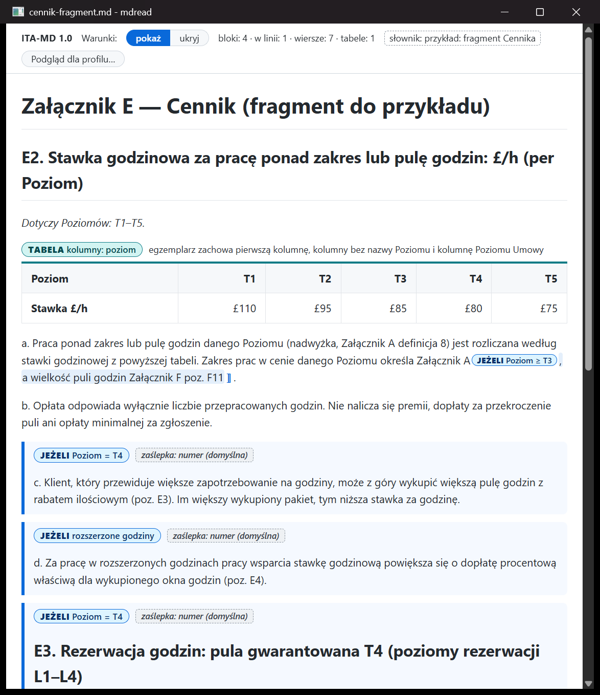
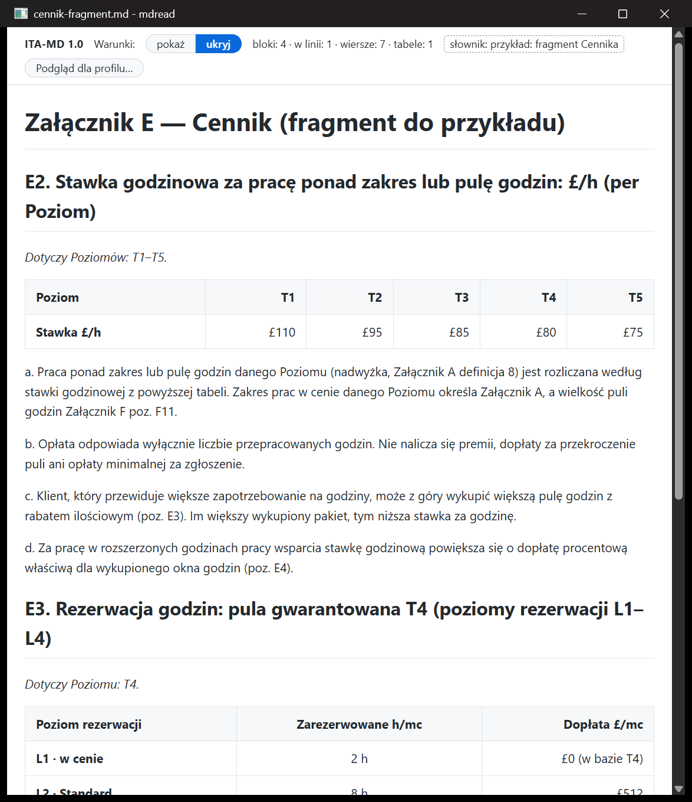
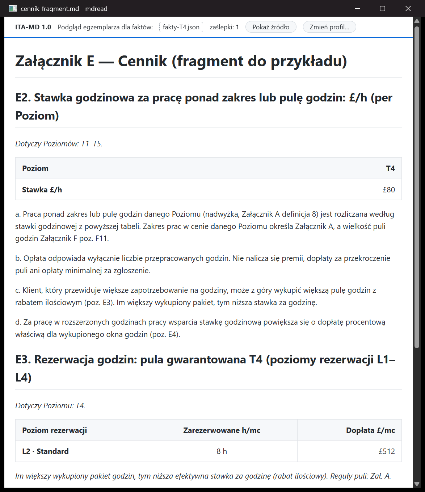

# Podręcznik standardu ITA-MD

| Pole | Wartość |
|---|---|
| **Wersja standardu** | ITA-MD 1.0 |
| **Wersja podręcznika** | 1.0 z 2026-10-12 |
| **Status** | Obowiązujący |
| **Właściciel standardu** | projekt md-files (ITAnalytics Ltd) |
| **Implementacje** | md-files 0.4.0 (biblioteka `md-core`: kompilator, przeglądarka mdread, konwertery md2html i md2docx) · implementacja referencyjna generatora umów w repozytorium BAU (`scripts/itamd.py`, `scripts/contract_assemble.py`) · port generatora w UAP |
| **Dziennik zmian standardu** | [CHANGELOG.md](CHANGELOG.md) (odrębny od wersji narzędzi) |
| **Przykłady** | katalog [przyklady/](przyklady/) |

Podręcznik jest jedynym źródłem wiedzy o standardzie. Opisuje składnię i znaczenie dyrektyw, zachowanie kompilatorów, przeglądarek i konwerterów, katalog błędów, reguły autorskie oraz migrację ze znaczników prowizorycznych. Gdy implementacja zachowuje się inaczej niż podręcznik, rację ma podręcznik, a rozbieżność trafia do rozdziału 20.

## Spis treści

1. [Cel i model źródło → egzemplarz](#1-cel-i-model-źródło--egzemplarz)
2. [Numeracja i wersjonowanie standardu](#2-numeracja-i-wersjonowanie-standardu)
3. [Poziomy zgodności](#3-poziomy-zgodności)
4. [Leksyka](#4-leksyka)
5. [Gramatyka](#5-gramatyka)
6. [Dyrektywy](#6-dyrektywy)
7. [Zagnieżdżanie](#7-zagnieżdżanie)
8. [Tabele GFM](#8-tabele-gfm)
9. [Wyrażenia](#9-wyrażenia)
10. [Słownik faktów i zestaw faktów](#10-słownik-faktów-i-zestaw-faktów)
11. [Semantyka kompilacji](#11-semantyka-kompilacji)
12. [Kolejność przebiegów i jej konsekwencje](#12-kolejność-przebiegów-i-jej-konsekwencje)
13. [Zachowanie kompilatora: fail closed](#13-zachowanie-kompilatora-fail-closed)
14. [Katalog błędów](#14-katalog-błędów)
15. [Reguły autorskie](#15-reguły-autorskie)
16. [Czytanie źródeł w mdread](#16-czytanie-źródeł-w-mdread)
17. [md2html i md2docx](#17-md2html-i-md2docx)
18. [Migracja ze znaczników prowizorycznych](#18-migracja-ze-znaczników-prowizorycznych)
19. [Przykład z szablonów BAU](#19-przykład-z-szablonów-bau)
20. [Zgodność implementacji](#20-zgodność-implementacji)
21. [Słowniczek](#21-słowniczek)
22. [Ściąga](#22-ściąga)

### Jak czytać

- Rozdziały 1–3: dla wszystkich. Czym jest ITA-MD, jak się go wersjonuje i czego wymaga od narzędzi.
- Rozdziały 4–10 i 15: dla autorów źródeł. Jak pisać dyrektywy, wyrażenia i słownik faktów.
- Rozdziały 11–14: dla twórców kompilatorów. Dokładne znaczenie, kolejność przebiegów, błędy.
- Rozdziały 16–19: narzędzia md-files, migracja i pełny przykład.

Słowa **MUSI**, **NIE MOŻE**, **POWINIEN** i **MOŻE** mają znaczenie normatywne: wymaganie bezwzględne, zakaz, zalecenie, możliwość.

**Przykłady są testami.** Każdy blok kodu z przykładem ITA-MD ma w nagłówku (po nazwie języka) atrybuty, które czyta zestaw testów biblioteki `md-core`: `oczekuj=ok` (przykład poprawny, bez ostrzeżeń), `oczekuj=IMD-101` (dokładnie te kody diagnostyk), `itamd-bez-dyrektyw` (wynik usunięcia dyrektyw), `itamd-egzemplarz` (wynik kompilacji), `itamd-kompilacja` (oczekiwane błędy kompilacji). Atrybuty widać tylko w pliku źródłowym podręcznika; w widoku czytelnika są niewidoczne. Dzięki temu każdy przykład w podręczniku jest sprawdzony na implementacji.

---

## 1. Cel i model źródło → egzemplarz

### 1.1 Cel

ITA-MD pozwala utrzymywać **jeden kanoniczny tekst** (np. komplet szablonów umów) dla wielu konfiguracji. W tekście źródłowym autor zaznacza, w jakiej konfiguracji ma zastosowanie blok tekstu, wiersz tabeli albo fragment zdania. Narzędzie, które zna konfigurację, wytwarza z tego tekstu **egzemplarz**: dokument dla jednej konfiguracji.

### 1.2 Model

Plik `.md` z dyrektywami jest **źródłem**, tak jak kod źródłowy programu. Egzemplarz jest wynikiem **kompilacji** źródła dla jednego **zestawu faktów** (np. Poziom usług T3, dyżur 24h wykupiony, brak oddziałów).

```text
źródło (.md + dyrektywy)  +  zestaw faktów (JSON)  ──kompilator──►  egzemplarz (.md)  ──►  scalenie pól, PDF, DOCX
          ▲                         ▲
   słownik faktów projektu (itamd-slownik.json): jakie fakty istnieją i jakiego są typu
```

Kompilacja jest **deterministyczna**: to samo źródło i ten sam zestaw faktów dają zawsze bajtowo ten sam egzemplarz. Kompilacja **nie** wypełnia pól (np. `{{contract.number}}`), nie liczy kwot i nie dołącza innych plików. To zadania narzędzi projektu, wykonywane po kompilacji.

### 1.3 Związek z konwencją notatek roboczych

ITA-MD rozszerza dialekt Markdown używany w projektach ITA, w którym plik `.md` jest źródłem, a dokument wynikowy jest egzemplarzem (README projektu md-files, „Source vs deliverable”). W tym dialekcie **notatka robocza** to cytat, którego pierwsza linia zaczyna się od emoji, zwykle z etykietą:

```markdown
> 📝 **[WORKING NOTE]** do uzgodnienia z działem prawnym
```

Narzędzia md-files pokazują notatki w przeglądarce i usuwają je z dokumentów wynikowych (md2docx domyślnie, md2html z opcją `--strip-notes`).

**Linia dyrektywy blokowej ITA-MD jest notatką roboczą z emoji 🔀** (U+1F500, „shuffle”). Dzięki temu:

- narzędzie, które nie zna ITA-MD, ale zna notatki, i tak nie przeniesie linii dyrektywy do dokumentu wynikowego;
- przeglądarka bez obsługi ITA-MD pokaże linię dyrektywy jako widoczny cytat, więc autor widzi warunek;
- emoji 🔀 jest zastrzeżone: cytat zaczynający się od 🔀 MUSI być poprawną linią dyrektywy (błąd IMD-004).

**Rozpoznawanie notatek (md-files od 0.4.0).** Notatką jest cytat, którego pierwsza linia po `>` zaczyna się od **emoji**: znaku z bloków symboli i piktogramów Unicode (U+1F000–U+1FAFF, U+2600–U+27BF, U+2300–U+23FF, U+2B00–U+2BFF oraz kilku pojedynczych znaków, np. ℹ). Litery dowolnego alfabetu, cudzysłowy, myślniki, wielokropek i strzałki nie są emoji, więc cytat `> „Cytat…”` albo `> Łukasz …` jest zwykłym cytatem i zostaje w dokumencie. Wcześniejsze wersje traktowały jako notatkę każdy cytat zaczynający się znakiem spoza Latin-1, co usuwało polskie cytaty.

### 1.4 Czego ITA-MD nie robi

- Nie ma zmiennych, pętli, dołączania plików ani obliczeń.
- Nie wypełnia pól `{{…}}`: scalenie wartości odbywa się zawsze **po** kompilacji, więc pole w zaślepionej jednostce znika razem z nią.
- Nie zastępuje słownika faktów projektu: standard określa składnię i znaczenie, a jakie fakty istnieją, decyduje projekt (rozdział 10).

---

## 2. Numeracja i wersjonowanie standardu

### 2.1 Numer wersji

Standard ma numer **ITA-MD MAJOR.MINOR**.

| Część | Kiedy rośnie | Skutek dla źródeł |
|---|---|---|
| **MAJOR** | zmiana składni albo znaczenia istniejącej dyrektywy, opcji lub reguły | źródła wymagają **migracji** (z instrukcją w dzienniku zmian) |
| **MINOR** | nowe słowo kluczowe, nowa opcja albo nowa możliwość, zgodna wstecz | istniejące źródła działają bez zmian i znaczą to samo |

Poprawki redakcyjne podręcznika, które nie zmieniają znaczenia, nie zmieniają numeru; dziennik zmian zapisuje je z datą.

### 2.2 Zgodność wsteczna

- Źródło zgodne z ITA-MD 1.x jest zgodne i znaczy to samo w każdej wersji 1.y, gdzie y ≥ x.
- Narzędzie obsługujące 1.y przyjmuje źródła 1.x.
- Źródło używające możliwości z 1.y w narzędziu 1.x daje błędy (np. IMD-002 przy nowym słowie kluczowym). Kompilator zatrzymuje się (rozdział 13), więc starsze narzędzie nigdy nie wytworzy błędnego egzemplarza po cichu.

### 2.3 Deklaracja wersji

- **Projekt** deklaruje wersję w pliku słownika faktów: `"standard": "ITA-MD 1.0"` (rozdział 10). Słownik z inną wersją główną (MAJOR) daje błąd IMD-502.
- **Narzędzia** deklarują obsługiwaną wersję: `md_core::itamd::STANDARD` w md-files, `VERSION` w `scripts/itamd.py` w BAU. Generator i każdy jego port MUSZĄ deklarować tę samą wersję co szablony, które wykonują.

### 2.4 Dziennik zmian

Zmiany standardu zapisuje [CHANGELOG.md](CHANGELOG.md) w tym katalogu. Jest on **odrębny** od dziennika zmian narzędzi md-files: wersja md-files (np. 0.4.0) i wersja standardu (ITA-MD 1.0) zmieniają się niezależnie.

### 2.5 Historia

| Wersja | Data | Opis |
|---|---|---|
| prowizoryczna (bez numeru) | 2026-10-12 | Znaczniki w komentarzach HTML (`<!-- @if … -->`). Wycofane; migracja w rozdziale 18. |
| **ITA-MD 1.0** | 2026-10-12 | Dyrektywy `⟦…⟧` oparte na konwencji notatek roboczych. |

---

## 3. Poziomy zgodności

Standard rozróżnia trzy role. Jedno narzędzie może pełnić kilka z nich (mdread jest przeglądarką i, w podglądzie dla profilu, kompilatorem).

### 3.1 Autor (źródło zgodne)

Źródło jest **zgodne** z ITA-MD 1.0, gdy sprawdzenie (np. `md_core::itamd::check`) nie zgłasza żadnego błędu. Źródło POWINNO być także w **postaci kanonicznej** (bez ostrzeżeń IMD-005) i POWINNO należeć do projektu, który ma słownik faktów (rozdział 10).

### 3.2 Przeglądarka i konwerter bez kompilacji

Przeglądarka (np. mdread, md2html bez opcji):

- MUSI pomijać dyrektywy w blokach kodu, fragmentach kodu i komentarzach HTML (4.9);
- MUSI pokazywać **wszystkie** gałęzie i NIE MOŻE domyślnie oceniać warunków ani ukrywać tekstu;
- MUSI pokazywać dyrektywy tak, by czytelnik je rozpoznał (dosłownie albo jako oznaczenia);
- POWINNA zgłaszać diagnostyki z kodami z katalogu (rozdział 14);
- MOŻE pozwalać ukryć oznaczenia dyrektyw (tekst wszystkich gałęzi zostaje widoczny);
- MOŻE oferować podgląd skompilowany dla zestawu faktów; w tym trybie jest kompilatorem (3.3).

Konwerter bez kompilacji (md2html `--strip-notes`, md2docx bez `--itamd-profile`) wytwarza dokument ze źródła, ale go nie kompiluje. Taki konwerter:

- MUSI usuwać linie dyrektyw blokowych (z jedną pustą linią po każdej) oraz dyrektywy w linii i wiersza, zachowując tekst **wszystkich** gałęzi;
- MUSI ostrzec dokładnie tym zdaniem: `plik zawiera dyrektywy ITA-MD 1.0 — to źródło, nie egzemplarz; użyj kompilatora`;
- NIE MOŻE przedstawiać wyniku jako egzemplarza (md2docx z `--final` odmawia konwersji, rozdział 17).

### 3.3 Kompilator

Kompilator:

- MUSI realizować pełną gramatykę (rozdział 5) i znaczenie (rozdziały 11–12), w tym kolejność przebiegów i dokładne brzmienia zaślepek;
- MUSI działać w trybie **fail closed** (rozdział 13): każdy błąd źródła, zestawu faktów albo oceny zatrzymuje kompilację i nie powstaje żaden egzemplarz;
- MUSI być deterministyczny;
- MUSI zgłaszać problemy kodami z katalogu (rozdział 14) z numerem linii źródła;
- MUSI sprawdzić zestaw faktów ze słownikiem projektu, jeżeli słownik jest dostępny;
- MOŻE wykonywać przetwarzanie właściwe projektowi przed kompilacją i po niej (np. wycięcie ciała klienckiego szablonu), o ile nie zmienia ono znaczenia dyrektyw.

---

## 4. Leksyka

### 4.1 Kodowanie

Źródło jest tekstem UTF-8. Znak BOM na początku pliku jest pomijany. Końce linii LF albo CRLF są równoważne; kompilator wytwarza egzemplarz z końcami LF. Słowa kluczowe zapisuje się w postaci znormalizowanej NFC (litera „Ż” jako jeden znak U+017B, nie „Z” z kropką łączącą).

### 4.2 Nawiasy

Dyrektywa zaczyna się znakiem `⟦` (U+27E6 MATHEMATICAL LEFT WHITE SQUARE BRACKET) i kończy znakiem `⟧` (U+27E7). Nawiasy:

- nie zagnieżdżają się: pierwszy `⟧` po `⟦` zamyka dyrektywę;
- muszą stać w tej samej linii (IMD-001);
- poza kodem występują **wyłącznie** jako dyrektywy. Samotny `⟧` to IMD-003, a `⟦` bez słowa kluczowego to IMD-002. Żeby napisać nawias w tekście, umieszcza się go we fragmencie kodu, np. `` `⟦` ``;
- znaki podobne (np. 〚 U+301A, [[ ]]) nie są nawiasami dyrektywy i zostają w tekście jako zwykłe znaki.

### 4.3 Słowa kluczowe

| Słowo kluczowe | Znaczenie | Wyrażenie | Opcje |
|---|---|---|---|
| `JEŻELI` | początek warunku (pierwsza gałąź) | wymagane | blok: `zaślepka` |
| `ALBO JEŻELI` | kolejna gałąź z warunkiem | wymagane | brak |
| `W PRZECIWNYM RAZIE` | gałąź bez warunku, ostatnia | brak | brak |
| `KONIEC` | koniec warunku | brak | brak |
| `WIERSZ` | warunek wiersza tabeli | wymagane | `zaślepka` |
| `TABELA` | projekcja kolumn tabeli | brak | `kolumny: poziom` (wymagana) |

Słowo kluczowe stoi bezpośrednio po `⟦`, wielkimi literami, z polskimi znakami. Po nim jest spacja i wyrażenie albo od razu `⟧`. `⟦jeżeli …⟧`, `⟦JEZELI …⟧` i `⟦JEŻELIx⟧` nie są dyrektywami (IMD-002).

### 4.4 Kropka środkowa

Opcje oddziela się od wyrażenia i od siebie **kropką środkową** „·” (U+00B7) otoczoną spacjami: ` · `. Inne znaki (•, ∙, ⋅, `|`, `;`, `,`) nie są separatorem: trafiają do wyrażenia i dają błąd składni (IMD-401) albo nieznaną opcję (IMD-006).

### 4.5 Opcje

Opcja ma postać `nazwa: wartość`. W ITA-MD 1.0 są dwie opcje:

| Opcja | Wartości | Gdzie | Domyślnie |
|---|---|---|---|
| `zaślepka` | `numer`, `tytuł`, `brak` | blokowe `JEŻELI`, `WIERSZ` | blok: `numer`; wiersz: `brak` |
| `kolumny` | `poziom` | `TABELA` (wymagana) | — |

### 4.6 Odstępy i postać kanoniczna

**Postać kanoniczna** to zapis z jedną spacją wszędzie tam, gdzie gramatyka ją przewiduje, i bez innych odstępów:

- jedna spacja między słowem kluczowym a wyrażeniem, brak spacji przed `⟧`;
- ` · ` przed każdą opcją, `: ` w opcji;
- w wyrażeniu jedna spacja wokół operatorów, `, ` na liście, bez spacji wewnątrz nawiasów.

Wewnątrz nawiasów `⟦ ⟧` dodatkowe albo brakujące odstępy nie zmieniają znaczenia: dyrektywa działa, a narzędzie zgłasza ostrzeżenie IMD-005 z postacią kanoniczną. **Kształt linii dyrektywy blokowej** (4.7) jest natomiast ścisły: każde odstępstwo to błąd IMD-004.

```markdown itamd id=kanon oczekuj=ok
> 🔀 ⟦JEŻELI tier >= T4 and not ef_dedicated · zaślepka: tytuł⟧

### § 2a. Parametry indywidualne SLA
> 🔀 ⟦KONIEC⟧
```

```markdown itamd id=niekanon oczekuj=IMD-005
Czas reakcji ⟦JEŻELI  tier>=T4⟧określa Załącznik D⟦KONIEC ⟧.
```

### 4.7 Linia dyrektywy blokowej

Dyrektywa blokowa i dyrektywa tabeli stoją w osobnej linii o dokładnie takim kształcie:

```text
<wcięcie>> 🔀 ⟦…⟧
```

- `<wcięcie>`: zero albo więcej **spacji** (tabulator to IMD-004). Wcięcie umieszcza dyrektywę w tym samym miejscu struktury dokumentu co treść, której dotyczy (np. w punkcie listy).
- `>`, potem **dokładnie jedna spacja**, potem 🔀 (U+1F500, **bez** selektora wariantu U+FE0F), potem **dokładnie jedna spacja**, potem **jedna** dyrektywa.
- Po dyrektywie mogą stać tylko białe znaki.

Przykłady błędnych linii (każda daje IMD-004):

```markdown itamd id=linia-dwie-spacje oczekuj=IMD-004
> 🔀 ⟦JEŻELI ef · zaślepka: brak⟧

Treść zależna od EF.
>  🔀 ⟦KONIEC⟧
```

```markdown itamd id=linia-bez-spacji oczekuj=IMD-004
> 🔀 ⟦JEŻELI ef · zaślepka: brak⟧

Treść zależna od EF.
> 🔀⟦KONIEC⟧
```

```markdown itamd id=linia-fe0f oczekuj=IMD-004
> 🔀 ⟦JEŻELI ef · zaślepka: brak⟧

Treść zależna od EF.
> 🔀️ ⟦KONIEC⟧
```

```markdown itamd id=linia-tekst-po oczekuj=IMD-004
> 🔀 ⟦KONIEC⟧ koniec bloku EF
```

```markdown itamd id=linia-bez-dyrektywy oczekuj=IMD-004
> 🔀 tu miała być dyrektywa
```

Gdy dyrektywa w błędnej linii jest czytelna (problem dotyczy tylko odstępów, wcięcia albo U+FE0F), narzędzia rozpoznają ją dalej, żeby błąd nie wywołał lawiny kolejnych, ale źródło jest niezgodne.

### 4.8 Obowiązkowa pusta linia

Po każdej linii dyrektywy blokowej i dyrektywy tabeli MUSI stać pusta linia (IMD-105). Z dwóch powodów:

1. W Markdown linia bez odstępu po cytacie zostałaby wciągnięta do cytatu (tzw. leniwa kontynuacja), więc treść stałaby się częścią notatki.
2. Kompilator i konwertery usuwają **linię dyrektywy razem z jedną pustą linią po niej**. Dzięki temu tekst wynikowy ma dokładnie taki układ, jaki miałoby źródło napisane bez dyrektyw.

Konsekwencja dla autora: gdy `⟦KONIEC⟧` stoi bezpośrednio pod treścią, a po bloku ma zostać pusta linia, po linii `⟦KONIEC⟧` pisze się **dwie** puste linie.

```markdown itamd id=pusta-linia oczekuj=ok
Przed blokiem.

> 🔀 ⟦JEŻELI standby24⟧

6. **Dyżur 24h.** ITA zapewnia całodobowy dyżur.
> 🔀 ⟦KONIEC⟧


Po bloku.
```

Po usunięciu dyrektyw:

```markdown itamd-bez-dyrektyw zrodlo=pusta-linia
Przed blokiem.

6. **Dyżur 24h.** ITA zapewnia całodobowy dyżur.

Po bloku.
```

Bez pustej linii:

```markdown itamd id=brak-pustej-linii oczekuj=IMD-105
> 🔀 ⟦JEŻELI standby24⟧
6. **Dyżur 24h.** ITA zapewnia całodobowy dyżur.
> 🔀 ⟦KONIEC⟧
```

### 4.9 Gdzie dyrektywy nie obowiązują

Dyrektyw nie ma w **blokach kodu** (ogrodzonych i wciętych), we **fragmentach kodu** (`` `…` ``) ani w **komentarzach HTML**. O tym, co jest kodem, rozstrzyga parser Markdown (CommonMark z rozszerzeniami GFM), a nie wygląd linii. Dzięki temu dokument może pokazywać dyrektywy jako przykłady, tak jak ten podręcznik.

````markdown itamd id=kod oczekuj=ok
Dyrektywę zamknięcia zapisuje się jako `⟦KONIEC⟧`.

```markdown
> 🔀 ⟦JEŻELI tier >= T4⟧
```

<!-- ⟦JEŻELI to tylko komentarz⟧ -->
````

---

## 5. Gramatyka

### 5.1 Notacja

EBNF: `=` definicja, `,` następstwo, `|` alternatywa, `[ … ]` opcjonalnie, `{ … }` zero albo więcej razy, `"…"` tekst dosłowny, `(* … *)` komentarz.

### 5.2 Dokument i linie

```text
źródło              = { linia } ;
linia               = linia-kodu | linia-blokowa | linia-tekstu ;
                      (* linia-kodu: linia w bloku kodu albo w blokowym komentarzu HTML; dyrektyw w niej nie ma *)

linia-blokowa       = wcięcie , ">" , " " , EMOJI , " " , dyrektywa-blokowa , { biały } ;
wcięcie             = { " " } ;
EMOJI               = ? znak U+1F500 ? ;
dyrektywa-blokowa   = "⟦" , ( jeżeli-blokowe | albo-jeżeli | w-przeciwnym-razie | koniec | tabela ) , "⟧" ;
jeżeli-blokowe      = "JEŻELI" , " " , wyrażenie , [ " · " , opcja-zaślepki ] ;
albo-jeżeli         = "ALBO JEŻELI" , " " , wyrażenie ;
w-przeciwnym-razie  = "W PRZECIWNYM RAZIE" ;
koniec              = "KONIEC" ;
tabela              = "TABELA" , " · " , "kolumny: poziom" ;

linia-tekstu        = { znak | dyrektywa-w-linii | dyrektywa-wiersza } ;
                      (* poza fragmentami kodu i komentarzami HTML *)
dyrektywa-w-linii   = "⟦" , ( "JEŻELI" , " " , wyrażenie
                            | "ALBO JEŻELI" , " " , wyrażenie
                            | "W PRZECIWNYM RAZIE"
                            | "KONIEC" ) , "⟧" ;
dyrektywa-wiersza   = "⟦" , "WIERSZ" , " " , wyrażenie , [ " · " , opcja-zaślepki ] , "⟧" ;
opcja-zaślepki      = "zaślepka: " , ( "numer" | "tytuł" | "brak" ) ;
znak                = ? dowolny znak poza "⟦" i "⟧" ? ;
biały               = " " | ? tabulator ? ;
```

Gramatyka opisuje postać kanoniczną. Odstępy wewnątrz nawiasów podlegają regule z 4.6.

### 5.3 Wyrażenie

```text
wyrażenie     = alternatywa ;
alternatywa   = koniunkcja , { "or" , koniunkcja } ;
koniunkcja    = negacja , { "and" , negacja } ;
negacja       = "not" , negacja | porównanie ;
porównanie    = składnik , [ operator , składnik | "in" , lista | "not" , "in" , lista ] ;
operator      = "==" | "!=" | "<" | "<=" | ">" | ">=" ;
składnik      = fakt | stała | "True" | "False" | "(" , wyrażenie , ")" ;
lista         = "[" , stała , { "," , stała } , "]" ;

fakt          = identyfikator ;  (* identyfikator, który nie jest stałą ani słowem wyrażenia *)
identyfikator = ( litera | "_" ) , { litera | cyfra | "_" } ;
litera        = "A" … "Z" | "a" … "z" ;  (* bez liter z polskimi znakami *)
cyfra         = "0" … "9" ;
stała         = "T1" … "T5" | "I1" … "I4" | "L1" … "L4" | "P1" … "P5" | "M0" … "M3"
              | "T5A" | "T5B" | "T5C" ;
```

Słowa wyrażenia (`and`, `or`, `not`, `in`, `True`, `False`) pisze się dokładnie tak. Identyfikator, który ma postać stałej z listy, **jest** stałą, nigdy faktem. Lista stałych jest częścią standardu 1.0; jej rozszerzenie to zmiana MINOR.

### 5.4 Reguły, których EBNF nie wyraża

| Reguła | Kod przy naruszeniu |
|---|---|
| Po linii dyrektywy blokowej albo tabeli stoi pusta linia | IMD-105 |
| `JEŻELI` blokowe ma swoje `KONIEC`; `ALBO JEŻELI` i `W PRZECIWNYM RAZIE` stoją wewnątrz bloku, `W PRZECIWNYM RAZIE` jest ostatnią gałęzią | IMD-101…104 |
| Linie jednego bloku mają to samo wcięcie | IMD-106 (ostrzeżenie) |
| Dyrektywy w linii są zrównoważone w obrębie linii i w obrębie jednej komórki tabeli | IMD-201…205 |
| `WIERSZ` stoi na samym początku pierwszej komórki wiersza danych tabeli; jeden na wiersz | IMD-301, IMD-302 |
| `TABELA` stoi w linii blokowej i po niej (po pustych liniach) zaczyna się tabela z nazwami Poziomów w nagłówku | IMD-303, IMD-304, IMD-307 |
| Każdy identyfikator należy do słownika faktów projektu | IMD-402 |
| Porównania kolejności tylko między Poziomami | IMD-403 |
| Blok z zaślepką `numer` albo `tytuł` zaczyna się od jednostki z oznaczeniem i obejmuje jedną jednostkę | IMD-601, IMD-602 |

---

## 6. Dyrektywy

### 6.1 Dyrektywa blokowa

Obejmuje linie między liniami dyrektyw. Gałęzie: `JEŻELI` (pierwsza), dowolnie wiele `ALBO JEŻELI`, opcjonalnie `W PRZECIWNYM RAZIE` (ostatnia), zawsze `KONIEC`.

```markdown itamd id=blok oczekuj=ok
> 🔀 ⟦JEŻELI tier >= T4⟧

6. **Rekompensata za naruszenie SLA.** Zasady określa Załącznik D §3a.
> 🔀 ⟦KONIEC⟧
```

Egzemplarz dla Poziomu T4 i dla Poziomu T2:

```json itamd-fakty id=f-t4
{"tier": "T4"}
```

```json itamd-fakty id=f-t2
{"tier": "T2"}
```

```markdown itamd-egzemplarz zrodlo=blok fakty=f-t4
6. **Rekompensata za naruszenie SLA.** Zasady określa Załącznik D §3a.
```

```markdown itamd-egzemplarz zrodlo=blok fakty=f-t2
6. Nie dotyczy niniejszej Umowy.
```

Z gałęziami:

```markdown itamd id=blok-galezie oczekuj=ok
> 🔀 ⟦JEŻELI tier == T5⟧

3. ITA zapewnia dyżur na wezwanie (on-call).
> 🔀 ⟦ALBO JEŻELI tier == T4⟧

3. ITA zapewnia kontakt telefoniczny w godzinach pracy wsparcia.
> 🔀 ⟦W PRZECIWNYM RAZIE⟧

3. Zgłoszenia przyjmuje się wyłącznie w kanale rejestrującym.
> 🔀 ⟦KONIEC⟧
```

```markdown itamd-egzemplarz zrodlo=blok-galezie fakty=f-t4
3. ITA zapewnia kontakt telefoniczny w godzinach pracy wsparcia.
```

```markdown itamd-egzemplarz zrodlo=blok-galezie fakty=f-t2
3. Zgłoszenia przyjmuje się wyłącznie w kanale rejestrującym.
```

Błędy:

```markdown itamd id=blok-bez-konca oczekuj=IMD-101
> 🔀 ⟦JEŻELI tier >= T4⟧

6. **Rekompensata.** Zasady określa Załącznik D.
```

```markdown itamd id=koniec-bez-jezeli oczekuj=IMD-102
6. **Rekompensata.** Zasady określa Załącznik D.
> 🔀 ⟦KONIEC⟧
```

```markdown itamd id=albo-poza-blokiem oczekuj=IMD-103
> 🔀 ⟦ALBO JEŻELI tier == T4⟧

3. Kontakt telefoniczny.
```

```markdown itamd id=galaz-po-inaczej oczekuj=IMD-104
> 🔀 ⟦JEŻELI tier == T5⟧

3. Dyżur na wezwanie.
> 🔀 ⟦W PRZECIWNYM RAZIE⟧

3. Kanał rejestrujący.
> 🔀 ⟦ALBO JEŻELI tier == T4⟧

Kontakt telefoniczny.
> 🔀 ⟦KONIEC⟧
```

```markdown itamd id=rozne-wciecia oczekuj=IMD-106
> 🔀 ⟦JEŻELI ef · zaślepka: brak⟧

1. Subskrypcja EF.
   > 🔀 ⟦KONIEC⟧
```

### 6.2 Dyrektywa w linii

Obejmuje fragment tekstu w jednej linii albo w jednej komórce tabeli. Gałąź, której warunek jest fałszywy, znika bez śladu (dyrektywa w linii nie ma zaślepki).

```markdown itamd id=w-linii oczekuj=ok
Szczegółową macierz ⟦JEŻELI tier >= T4⟧określają Załączniki A i D⟦W PRZECIWNYM RAZIE⟧określa Załącznik A⟦KONIEC⟧.
```

```markdown itamd-egzemplarz zrodlo=w-linii fakty=f-t4
Szczegółową macierz określają Załączniki A i D.
```

```markdown itamd-egzemplarz zrodlo=w-linii fakty=f-t2
Szczegółową macierz określa Załącznik A.
```

Łańcuch gałęzi i zagnieżdżenie:

```markdown itamd id=w-linii-lancuch oczekuj=ok
Osoby upoważnione: ⟦JEŻELI tier == T1⟧**1** osoba⟦ALBO JEŻELI tier == T2⟧**2** osoby⟦W PRZECIWNYM RAZIE⟧co najmniej **3** osoby⟦JEŻELI tier == T5⟧ (oraz dyżur na wezwanie)⟦KONIEC⟧⟦KONIEC⟧.
```

```json itamd-fakty id=f-t5
{"tier": "T5"}
```

```markdown itamd-egzemplarz zrodlo=w-linii-lancuch fakty=f-t2
Osoby upoważnione: **2** osoby.
```

```markdown itamd-egzemplarz zrodlo=w-linii-lancuch fakty=f-t5
Osoby upoważnione: co najmniej **3** osoby (oraz dyżur na wezwanie).
```

Błędy:

```markdown itamd id=w-linii-bez-konca oczekuj=IMD-201
Szczegóły ⟦JEŻELI tier >= T4⟧określa Załącznik D.
```

```markdown itamd id=w-linii-koniec-bez oczekuj=IMD-202
Szczegóły określa Załącznik D⟦KONIEC⟧.
```

```markdown itamd id=w-linii-inaczej-bez oczekuj=IMD-203
Szczegóły określa ⟦W PRZECIWNYM RAZIE⟧Załącznik A.
```

```markdown itamd id=w-linii-po-inaczej oczekuj=IMD-204
Kontakt: ⟦JEŻELI tier == T5⟧dyżur⟦W PRZECIWNYM RAZIE⟧kanał⟦ALBO JEŻELI tier == T4⟧telefon⟦KONIEC⟧.
```

```markdown itamd id=w-linii-zaslepka oczekuj=IMD-008
Szczegóły określa Załącznik A⟦JEŻELI tier >= T4 · zaślepka: brak⟧ i D⟦KONIEC⟧.
```

```markdown itamd id=w-linii-komorki oczekuj=IMD-205
| Wymiar | Opis | Źródło |
|---|---|---|
| Czas reakcji | ⟦JEŻELI tier >= T4⟧wg SLA | Załącznik D⟦KONIEC⟧ |
```

Dyrektywa w linii **nie przechodzi do następnej linii**: każda linia jest zrównoważona sama w sobie. Akapit złożony z kilku linii wymaga osobnej dyrektywy w każdej linii albo dyrektywy blokowej.

### 6.3 Dyrektywa wiersza

Stoi na **samym początku pierwszej komórki** wiersza danych tabeli GFM. Wiersz zaczyna się od `|`. Gdy warunek jest fałszywy, wiersz znika (domyślnie), albo zostaje z zaślepką w komórce (`zaślepka: numer`, `zaślepka: tytuł`, rozdział 11.3).

```markdown itamd id=wiersz oczekuj=ok
| Poz. | Świadczenie | Opłata |
|---|---|---|
| ⟦WIERSZ holidays · zaślepka: numer⟧**E5.1** | Praca w święta | **+20%** |
| ⟦WIERSZ standby24 · zaślepka: tytuł⟧**E5.2** | Dyżur 24h | **+20%** |
| ⟦WIERSZ standby24⟧**E5.3** | Dyżur 24h, kolejne okno | **£250** |
```

```json itamd-fakty id=f-bez-swiadczen
{"holidays": false, "standby24": false}
```

```markdown itamd-egzemplarz zrodlo=wiersz fakty=f-bez-swiadczen
| Poz. | Świadczenie | Opłata |
|---|---|---|
| **E5.1** | nie dotyczy niniejszej Umowy |  |
| **E5.2** | Dyżur 24h | nie dotyczy niniejszej Umowy |
```

Błędy:

```markdown itamd id=wiersz-druga-komorka oczekuj=IMD-301
| Poz. | Świadczenie |
|---|---|
| **E5.1** | ⟦WIERSZ holidays⟧Praca w święta |
```

```markdown itamd id=wiersz-nie-na-poczatku oczekuj=IMD-301
| Poz. | Świadczenie |
|---|---|
| **E5.1** ⟦WIERSZ holidays⟧ | Praca w święta |
```

```markdown itamd id=wiersz-naglowek oczekuj=IMD-301
| ⟦WIERSZ holidays⟧Poz. | Świadczenie |
|---|---|
| **E5.1** | Praca w święta |
```

```markdown itamd id=wiersz-poza-tabela oczekuj=IMD-301
⟦WIERSZ holidays⟧Praca w święta.
```

```markdown itamd id=wiersz-dwa oczekuj=IMD-302
| Poz. | Świadczenie |
|---|---|
| ⟦WIERSZ holidays⟧⟦WIERSZ standby24⟧**E5** | Świadczenia |
```

```markdown itamd id=wiersz-blokowy oczekuj=IMD-306
> 🔀 ⟦WIERSZ holidays⟧

| Poz. | Świadczenie |
|---|---|
| **E5.1** | Praca w święta |
```

```markdown itamd id=wiersz-bez-wyrazenia oczekuj=IMD-010
| Poz. | Świadczenie |
|---|---|
| ⟦WIERSZ · zaślepka: numer⟧**E5.1** | Praca w święta |
```

### 6.4 Dyrektywa tabeli

`> 🔀 ⟦TABELA · kolumny: poziom⟧` przed tabelą, której nagłówek nazywa Poziomy (T1…T5). W egzemplarzu zostaje kolumna pierwsza, kolumny bez nazwy Poziomu i kolumna Poziomu Umowy (fakt `tier`). Wiersze z pustą komórką Poziomu („—”) znikają (11.4).

```markdown itamd id=tabela oczekuj=ok
> 🔀 ⟦TABELA · kolumny: poziom⟧

| Wymiar | T1 | T2 | T3 |
|---|---|---|---|
| Naprawy błędów | w miarę możliwości | w miarę możliwości | priorytetowo |
| Pula godzin | — | — | h/mc |
```

```json itamd-fakty id=f-t3
{"tier": "T3"}
```

```markdown itamd-egzemplarz zrodlo=tabela fakty=f-t2
| Wymiar | T2 |
| --- | --- |
| Naprawy błędów | w miarę możliwości |
```

```markdown itamd-egzemplarz zrodlo=tabela fakty=f-t3
| Wymiar | T3 |
| --- | --- |
| Naprawy błędów | priorytetowo |
| Pula godzin | h/mc |
```

Błędy:

```markdown itamd id=tabela-w-linii oczekuj=IMD-303
Tabela poniżej ⟦TABELA · kolumny: poziom⟧ dotyczy Poziomów.
```

```markdown itamd id=tabela-bez-tabeli oczekuj=IMD-304
> 🔀 ⟦TABELA · kolumny: poziom⟧

Tu miała być tabela.
```

```markdown itamd id=tabela-bez-opcji oczekuj=IMD-305
> 🔀 ⟦TABELA⟧

| Wymiar | T1 | T2 |
|---|---|---|
| Naprawy | tak | tak |
```

```markdown itamd id=tabela-bez-poziomow oczekuj=IMD-307
> 🔀 ⟦TABELA · kolumny: poziom⟧

| Wymiar | Opis |
|---|---|
| Naprawy | tak |
```

### 6.5 Błędy wspólne dla wszystkich dyrektyw

```markdown itamd id=niezamknieta oczekuj=IMD-001
Zakres określa Załącznik A⟦JEŻELI tier >= T3, a pulę Załącznik F.
```

```markdown itamd id=slowo-kluczowe oczekuj=IMD-002,IMD-202
Zakres ⟦jeżeli tier >= T3⟧i pula⟦KONIEC⟧ określa Załącznik A.
```

```markdown itamd id=samotny-nawias oczekuj=IMD-003
Stawka ⟧ w tekście.
```

```markdown itamd id=nieznana-opcja oczekuj=IMD-006
> 🔀 ⟦JEŻELI ef · kolor: zielony⟧

1. Subskrypcja EF.
> 🔀 ⟦KONIEC⟧
```

```markdown itamd id=nieznana-wartosc oczekuj=IMD-007
> 🔀 ⟦JEŻELI ef · zaślepka: tytul⟧

1. Subskrypcja EF.
> 🔀 ⟦KONIEC⟧
```

```markdown itamd id=opcja-nie-tu oczekuj=IMD-008
> 🔀 ⟦JEŻELI tier == T5⟧

3. Dyżur na wezwanie.
> 🔀 ⟦ALBO JEŻELI tier == T4 · zaślepka: numer⟧

3. Kontakt telefoniczny.
> 🔀 ⟦KONIEC⟧
```

```markdown itamd id=opcja-dwa-razy oczekuj=IMD-009
> 🔀 ⟦JEŻELI ef · zaślepka: numer · zaślepka: brak⟧

1. Subskrypcja EF.
> 🔀 ⟦KONIEC⟧
```

```markdown itamd id=brak-wyrazenia oczekuj=IMD-010
> 🔀 ⟦JEŻELI⟧

1. Subskrypcja EF.
> 🔀 ⟦KONIEC⟧
```

```markdown itamd id=zbedne-wyrazenie oczekuj=IMD-011
> 🔀 ⟦JEŻELI ef⟧

1. Subskrypcja EF.
> 🔀 ⟦KONIEC ef⟧
```

---

## 7. Zagnieżdżanie

- Bloki zagnieżdżają się bez ograniczeń. Blok wewnętrzny leży w całości w jednej gałęzi bloku zewnętrznego.
- W bloku mogą stać dyrektywy w linii, wiersza i tabeli.
- Dyrektywy w linii zagnieżdżają się w obrębie linii (przykład w 6.2).
- Linie jednego bloku POWINNY mieć to samo wcięcie (IMD-106). Wcięcie wskazuje miejsce bloku w strukturze dokumentu (lista, punkt, poziom zagłębienia).
- Blok nie zaczyna się i nie kończy wewnątrz tabeli: linia dyrektywy między wierszami zakończyłaby tabelę (rozdział 8).

```markdown itamd id=zagniezdzenie oczekuj=ok
> 🔀 ⟦JEŻELI ef⟧

## E12. Subskrypcja EF / KSeF: siatka planów

| Plan | Abonament £/mc |
|---|---:|
| E0 | £2 |
| ⟦WIERSZ api⟧E1 (z API) | £18 |

> 🔀 ⟦JEŻELI ef_dedicated · zaślepka: brak⟧

**Dedykowana infrastruktura EF**⟦JEŻELI tier >= T4⟧ (zgodnie z Załącznikiem D)⟦KONIEC⟧: linia planu EF **−37,3%**.
> 🔀 ⟦KONIEC⟧

> 🔀 ⟦KONIEC⟧
```

```json itamd-fakty id=f-ef
{"ef": true, "api": false, "ef_dedicated": true, "tier": "T4"}
```

```markdown itamd-egzemplarz zrodlo=zagniezdzenie fakty=f-ef
## E12. Subskrypcja EF / KSeF: siatka planów

| Plan | Abonament £/mc |
|---|---:|
| E0 | £2 |

**Dedykowana infrastruktura EF** (zgodnie z Załącznikiem D): linia planu EF **−37,3%**.
```

---

## 8. Tabele GFM

**Dlaczego dyrektywa wiersza stoi w komórce.** Linia cytatu (a więc linia dyrektywy blokowej) między wierszami tabeli **kończy tabelę** w parserze GFM. Dalsze wiersze stają się zwykłym akapitem. Dlatego warunek wiersza zapisuje się wewnątrz pierwszej komórki, a nie w osobnej linii.

Poniższy przykład pokazuje skutek błędnego zapisu: „wiersz” `| 3 | 4 |` przestał być wierszem tabeli. Narzędzie zgłasza IMD-602, bo blok z domyślną zaślepką zaczyna się od akapitu, a nie od jednostki z oznaczeniem.

```markdown itamd id=blok-w-tabeli oczekuj=IMD-602
| Plan | Abonament |
|---|---|
| E0 | £2 |
> 🔀 ⟦JEŻELI api⟧

| E1 | £18 |
> 🔀 ⟦KONIEC⟧
```

Reguły tabel:

- Dyrektywa wiersza stoi w wierszu **danych** (nie w nagłówku: wiersz nagłówka nie może zniknąć) i w **pierwszej** komórce, na samym jej początku. Wiersz zaczyna się od `|`.
- Jeden wiersz, jedna dyrektywa `WIERSZ`.
- Dyrektywy w linii w komórkach są dozwolone, ale każda grupa `⟦JEŻELI⟧ … ⟦KONIEC⟧` mieści się w jednej komórce (IMD-205), bo inaczej kompilacja usunęłaby separator `|`.
- Dyrektywa tabeli projektuje kolumny według nagłówka: kolumna jest kolumną Poziomu, gdy jej nagłówek zawiera nazwę Poziomu `T1`…`T5` jako osobne słowo (`**T3 Priority**` tak, `T5A` nie).
- Wiersz zapisany przez kompilator ma postać `| a | b |` (komórki rozdzielone ` | `). Dotyczy to wierszy z zaślepką i tabel projektowanych przez `TABELA` (łącznie z wierszem wyrównania, np. `| --- | --: |`).

---

## 9. Wyrażenia

### 9.1 Wartości

| Składnik | Wartość |
|---|---|
| fakt logiczny | `true` albo `false` z zestawu faktów |
| fakt tekstowy (Poziom, wyliczeniowy) | tekst z zestawu faktów; pusty tekst znaczy „nie ustawiono” |
| stała (`T4`, `L2`, `I1`, …) | tekst równy swojej nazwie |
| `True`, `False` | prawda, fałsz |

Warunek jest spełniony, gdy jego wartość jest „prawdziwa”: `true` dla wartości logicznej, niepusty tekst dla tekstu. Fakt tekstowy sam w sobie (`⟦JEŻELI reservation⟧`) znaczy więc „ustawiony”.

### 9.2 Operatory i pierwszeństwo

| Pierwszeństwo | Operator | Znaczenie | Przeglądarka pokazuje |
|---|---|---|---|
| 1 (najsłabsze) | `or` | alternatywa | „lub” |
| 2 | `and` | koniunkcja | „i” |
| 3 | `not` | negacja | „nie” |
| 4 | `==`, `!=` | równość, różność (wartości różnych rodzajów są różne; nigdy błąd) | `=`, `≠` |
| 4 | `<`, `<=`, `>`, `>=` | kolejność, **wyłącznie między Poziomami** T1 < T2 < T3 < T4 < T5 | `<`, `≤`, `>`, `≥` |
| 4 | `in`, `not in` | przynależność do listy stałych | „w”, „nie w” |

- `not tier == T1` znaczy `not (tier == T1)`.
- Porównania nie łączą się w łańcuch (`T1 < tier < T4` to błąd); używa się `and`.
- Kolejność Poziomów jest jawna, nie alfabetyczna. Porównanie kolejności innych wartości to błąd: statycznie IMD-403, podczas kompilacji IMD-604.
- Wszystkie składniki `and` i `or` są oceniane (bez skracania), więc brak faktu jest błędem także wtedy, gdy wynik byłby już przesądzony.

### 9.3 Poprawne i błędne wyrażenia

Poprawne (każda linia to jedno wyrażenie w postaci kanonicznej):

```text itamd-wyrazenie oczekuj=ok
tier >= T4
tier == T4 or tier == T5
ef and not ef_dedicated
infra_m1 or infra_m3 or ef
holidays and standby24
sla_intensity in [I1, I2, I3]
reservation not in [L1]
(ef or api) and tier >= T3
reservation
True
```

Błędne (IMD-401):

```text itamd-wyrazenie oczekuj=IMD-401
tier = T4
ef && api
ef || api
!ef
tier ≥ T4
T1 < tier < T4
tier == "T4"
tier == 4
poziom_usług
ef i api
ef AND api
x in [I1, tier]
(ef or api
```

Kontrole statyczne ze słownikiem faktów:

```json itamd-slownik id=s-wyr
{
  "standard": "ITA-MD 1.0",
  "fakty": {
    "tier": {"typ": "poziom", "etykieta": "Poziom"},
    "ef": {"typ": "logiczny", "etykieta": "EF/KSeF"},
    "reservation": {"typ": "wyliczeniowy", "wartości": ["L1", "L2", "L3", "L4"], "etykieta": "rezerwacja godzin"}
  }
}
```

```markdown itamd id=spoza-slownika oczekuj=IMD-402 slownik=s-wyr
Kontakt telefoniczny⟦JEŻELI standby24⟧ i dyżur⟦KONIEC⟧.
```

```markdown itamd id=kolejnosc-poza-poziomami oczekuj=IMD-403 slownik=s-wyr
Pula⟦JEŻELI tier == T4 and reservation >= L2⟧ powiększona⟦KONIEC⟧.
```

```markdown itamd id=spoza-dziedziny oczekuj=IMD-405 slownik=s-wyr
Pula⟦JEŻELI reservation == I2⟧ powiększona⟦KONIEC⟧.
```

Bez słownika narzędzie nie wie, które identyfikatory są faktami, ale ostrzega przed identyfikatorem, który wygląda na stałą spoza zakresu:

```markdown itamd id=jak-stala oczekuj=IMD-404
Pod-pasmo⟦JEŻELI tier == T6⟧ T6⟦KONIEC⟧.
```

---

## 10. Słownik faktów i zestaw faktów

### 10.1 Pojęcie

**Fakt** to nazwana wartość opisująca konfigurację (np. `tier`, `standby24`). Zbiór faktów jest **zamknięty** i należy do **projektu**, który pisze źródła z dyrektywami. Dla szablonów umów właścicielem jest projekt BAU (algorytm generatora, §6). Standard nie definiuje żadnego faktu poza jednym wymaganiem: dyrektywa `TABELA` czyta Poziom konfiguracji z faktu `tier` (10.4).

Dodanie, zmiana albo usunięcie faktu to zmiana **słownika projektu**, nie standardu. Najpierw zmienia się słownik, potem źródła.

### 10.2 Plik słownika: `itamd-slownik.json`

Projekt deklaruje słownik w pliku **`itamd-slownik.json`** w katalogu źródeł albo w dowolnym katalogu nadrzędnym. Narzędzia szukają go, idąc od katalogu dokumentu w górę; obowiązuje **pierwszy** znaleziony plik. Słownik:

- deklaruje wersję standardu (`standard`), więc jest też deklaracją wersji projektu (2.3);
- pozwala sprawdzić każdy identyfikator w źródle (IMD-402) i każdą stałą porównywaną z faktem (IMD-403, IMD-405);
- pozwala sprawdzić zestaw faktów przed kompilacją (IMD-503…505);
- daje przeglądarkom krótkie etykiety (`etykieta`), które zastępują identyfikatory w oznaczeniach, oraz opisy (`opis`) w podpowiedziach.

| Pole | Wymagane | Znaczenie |
|---|---|---|
| `standard` | tak | `"ITA-MD MAJOR.MINOR"`, np. `"ITA-MD 1.0"` |
| `nazwa` | nie | nazwa słownika w komunikatach |
| `opis` | nie | opis słownika |
| `fakty` | tak | obiekt: nazwa faktu → definicja |
| `fakty.*.typ` | tak | `logiczny`, `poziom` albo `wyliczeniowy` |
| `fakty.*.wartości` | dla `wyliczeniowy` | niepusta lista stałych ITA-MD (np. `["L1", "L2"]`); dla innych typów zabronione |
| `fakty.*.etykieta` | nie | krótka nazwa dla czytelnika, np. `"Poziom"` |
| `fakty.*.opis` | nie | co fakt znaczy i skąd bierze się wartość |

| Typ | Wartość w zestawie faktów |
|---|---|
| `logiczny` | `true` albo `false` |
| `poziom` | jeden z `"T1"` … `"T5"`; jedyny typ z kolejnością |
| `wyliczeniowy` | jedna z `wartości` albo `""` (nie ustawiono) |

Nazwa faktu jest identyfikatorem (5.3): litery łacińskie bez znaków diakrytycznych, cyfry, `_`. Nie może być stałą ani słowem wyrażenia. Nieznany klucz to błąd IMD-501; wyjątek: klucze ze słownika, który deklaruje nowszą wersję MINOR niż obsługiwana przez narzędzie, są pomijane (zgodność w przód w obrębie wersji głównej).

```json itamd-slownik id=s-przyklad
{
  "standard": "ITA-MD 1.0",
  "nazwa": "umowy (fragment)",
  "fakty": {
    "tier": {"typ": "poziom", "etykieta": "Poziom", "opis": "Poziom usług T1–T5"},
    "standby24": {"typ": "logiczny", "etykieta": "dyżur 24h"},
    "reservation": {"typ": "wyliczeniowy", "wartości": ["L1", "L2", "L3", "L4"], "etykieta": "rezerwacja godzin"}
  }
}
```

Błędne słowniki:

```json itamd-slownik id=s-zly oczekuj=IMD-501
{
  "standard": "ITA-MD 1.0",
  "fakty": {
    "poziom_usług": {"typ": "poziom"},
    "rezerwacja": {"typ": "wyliczeniowy"}
  }
}
```

```json itamd-slownik id=s-inna-wersja oczekuj=IMD-502
{"standard": "ITA-MD 2.0", "fakty": {}}
```

### 10.3 Zestaw faktów (plik faktów, profil)

**Zestaw faktów** opisuje jedną konfigurację: obiekt JSON z wartościami faktów. Może to być sam obiekt faktów albo obiekt, w którym fakty są w polu `fakty` (lub `facts`, jak w manifeście generatora BAU). Wartości: `true`/`false` (fakty logiczne), tekst (Poziom, wyliczeniowy), `null` (pusty tekst, „nie ustawiono”). Liczby, listy i obiekty to błąd IMD-505. Niepoprawny JSON to IMD-506. W narzędziach md-files zestaw faktów nazywa się też **profilem** („Podgląd dla profilu…”, `--itamd-profile`).

```json itamd-fakty id=f-przyklad
{"tier": "T4", "standby24": true, "reservation": "L2"}
```

```json itamd-fakty id=f-zly oczekuj=IMD-506
{"tier": "T4",}
```

Ze słownikiem kompilator sprawdza zestaw przed oceną: każdy fakt słownika jest obecny (IMD-503), nie ma faktów spoza słownika (IMD-504), każda wartość ma właściwy typ (IMD-505).

```json itamd-fakty id=f-niepelny
{"tier": "T4", "standby24": "tak", "oddzialy": true}
```

```text itamd-kompilacja zrodlo=blok fakty=f-niepelny slownik=s-przyklad
IMD-503 (błąd): brak faktu „reservation” w zestawie faktów
IMD-504 (błąd): fakt „oddzialy” nie należy do słownika „umowy (fragment)”
IMD-505 (błąd): fakt „standby24” (typ logiczny) ma wartość "tak"; oczekiwano: true albo false
```

### 10.4 Fakt `tier`

Dyrektywa `TABELA · kolumny: poziom` czyta Poziom konfiguracji z faktu o nazwie **`tier`**. Projekt, który używa `TABELA`, MUSI mieć w słowniku fakt `tier` typu `poziom`.

### 10.5 Słownik projektu BAU

Słownik umów T1–T5 (44 fakty) jest opisany w dokumencie BAU „Algorytm generatora egzemplarza umowy” (§6) i zdefiniowany w kodzie generatora (`VOCAB` w `scripts/contract_assemble.py`). Zalecenie: BAU zapisuje go jako `itamd-slownik.json` w katalogu szablonów, z etykietami dla przeglądarek. Wtedy mdread i md2html pokazują warunki językiem czytelnika („Poziom ≥ T4”, „dyżur 24h”) i sprawdzają każdy identyfikator.

---

## 11. Semantyka kompilacji

### 11.1 Bloki

Dla każdego bloku, od początku dokumentu, kompilator ocenia warunki gałęzi `JEŻELI` i `ALBO JEŻELI` po kolei i bierze **pierwszą prawdziwą**. Gdy żadna nie jest prawdziwa, bierze gałąź `W PRZECIWNYM RAZIE`. Gdy jej nie ma, wstawia **zaślepkę** (11.2). Bloki zagnieżdżone w wybranej gałęzi kompiluje się tak samo; gałęzi niewybranych się nie ocenia.

Linia każdej dyrektywy blokowej znika **razem z jedną pustą linią po niej** (4.8).

### 11.2 Zaślepki

Dozwolone są **wyłącznie dwa brzmienia**:

| Gdzie | Brzmienie |
|---|---|
| blok (akapit) | `Nie dotyczy niniejszej Umowy.` |
| komórka tabeli | `nie dotyczy niniejszej Umowy` |

Treść zaślepki bloku zależy od **pierwszej linii bloku**: pierwszej niepustej linii pierwszej gałęzi (jeżeli gałąź zaczyna się od bloku zagnieżdżonego, to pierwszej linii jego pierwszej gałęzi), po usunięciu dyrektyw. Kompilator rozpoznaje w niej **oznaczenie jednostki**:

- **nagłówek** `#`…`######`, a w jego tekście oznaczenie: opcjonalnie `§` (ze spacją albo bez), opcjonalna wielka litera, cyfry, opcjonalna mała litera, opcjonalnie `.cyfry`, opcjonalna kropka, potem spacja albo koniec. Przykłady: `E10.`, `§ 1a.`, `4.`, `E5.1`, `E16.3.`;
- **punkt**: wcięcie, potem `6.`, `1a.`, `a.` albo `1)`, potem spacja.

| `zaślepka:` | pierwsza linia | wynik |
|---|---|---|
| `numer` (domyślna) | `## E10. Tryb CITO…` | `## E10.`, pusta linia, `Nie dotyczy niniejszej Umowy.` |
| `numer` | `6. **Tytuł.** treść…` | `6. Nie dotyczy niniejszej Umowy.` |
| `tytuł` | `### § 1a. Zastąpienie…` | cały nagłówek, pusta linia, `Nie dotyczy niniejszej Umowy.` |
| `tytuł` | `6. **Tytuł.** treść…` | `6. **Tytuł.** Nie dotyczy niniejszej Umowy.` (pogrubiona etykieta z początku punktu) |
| `brak` | dowolna | nic |

Nagłówek bez oznaczenia (np. `## Tabela zbiorcza`) zostaje w całości także przy `numer`. Blok z zaślepką `numer` albo `tytuł`, którego pierwsza linia nie jest nagłówkiem ani punktem, to błąd IMD-602.

```markdown itamd id=zaslepki oczekuj=ok
> 🔀 ⟦JEŻELI tier >= T4⟧

## E10. Tryb CITO: realizacja natychmiastowa

Opłata za uruchomienie trybu CITO: £40.
> 🔀 ⟦KONIEC⟧


> 🔀 ⟦JEŻELI tier >= T4 · zaślepka: tytuł⟧

### § 2a. Parametry indywidualne SLA

1. Paragraf stosuje się do Poziomów T4 i T5.
> 🔀 ⟦KONIEC⟧


> 🔀 ⟦JEŻELI standby24 · zaślepka: tytuł⟧

7. **Dyżur 24h.** ITA zapewnia całodobowy dyżur.
> 🔀 ⟦KONIEC⟧


> 🔀 ⟦JEŻELI standby24 · zaślepka: brak⟧

Dyżur jest rozliczany według poz. E5.2.
> 🔀 ⟦KONIEC⟧
```

```json itamd-fakty id=f-t2-bez
{"tier": "T2", "standby24": false}
```

```markdown itamd-egzemplarz zrodlo=zaslepki fakty=f-t2-bez
## E10.

Nie dotyczy niniejszej Umowy.

### § 2a. Parametry indywidualne SLA

Nie dotyczy niniejszej Umowy.

7. **Dyżur 24h.** Nie dotyczy niniejszej Umowy.
```

**Jedna jednostka na blok z zaślepką.** Gałąź bloku z zaślepką `numer` albo `tytuł`, który nie zaczyna się od nagłówka, może zawierać tylko jedną linię będącą nagłówkiem albo punktem na poziomie bloku (punkty głębiej wcięte się nie liczą). Inaczej zaślepka zastąpiłaby kilka jednostek jednym oznaczeniem i numeracja by zniknęła (IMD-601).

```markdown itamd id=dwie-jednostki oczekuj=IMD-601
> 🔀 ⟦JEŻELI standby24⟧

6. **Dyżur 24h.** ITA zapewnia całodobowy dyżur.
7. **Okna dyżuru.** Kolejne okna rozlicza się osobno.
> 🔀 ⟦KONIEC⟧
```

### 11.3 Wiersze

- Warunek prawdziwy: wiersz zostaje; dyrektywa znika razem z białymi znakami po niej, a ciąg `|  ` (kreska i dwie spacje) zamienia się na `| `.
- Warunek fałszywy, bez opcji albo `zaślepka: brak`: wiersz znika.
- `zaślepka: numer`: zostaje pierwsza komórka; w drugiej jest `nie dotyczy niniejszej Umowy`; pozostałe komórki są puste.
- `zaślepka: tytuł`: zostają dwie pierwsze komórki (gdy tabela ma ich więcej niż dwie); w trzeciej jest `nie dotyczy niniejszej Umowy`; pozostałe są puste.

Przykład w 6.3.

### 11.4 Tabele Poziomu

Dla tabeli pod `⟦TABELA · kolumny: poziom⟧` kompilator:

1. usuwa linię dyrektywy i wszystkie puste linie między nią a tabelą;
2. zostawia kolumny: pierwszą (zawsze), każdą, której nagłówek nie nazywa Poziomu, oraz kolumnę Poziomu równego faktowi `tier`;
3. usuwa wiersze danych, w których komórka Poziomu Umowy jest pusta: `—`, `–` albo `-`, ewentualnie z dopiskiem w nawiasie, np. `— (brak)`;
4. zapisuje tabelę w postaci `| a | b |`.

Przykład w 6.4.

### 11.5 Dyrektywy w linii

Kompilator czyta linię od lewej, ze stosem otwartych warunków. Tekst trafia do wyniku tylko wtedy, gdy **wszystkie** otwarte warunki nad nim są prawdziwe w swoich bieżących gałęziach. `ALBO JEŻELI` jest oceniane tylko wtedy, gdy żadna wcześniejsza gałąź grupy nie została wybrana. Tekst między dyrektywami przechodzi **dokładnie** (ze spacjami), dlatego autor umieszcza spacje i znaki interpunkcyjne wewnątrz gałęzi tak, żeby każda wersja zdania była poprawna (reguła autorska 2).

### 11.6 Porządkowanie

Po przebiegach kompilator porządkuje tekst (poza blokami kodu):

1. linia `---`, oddzielona od poprzedniej linii `---` wyłącznie pustymi liniami (co najmniej jedną), znika razem z tymi pustymi liniami; usunięte sekcje nie zostawiają więc stosu linii poziomych;
2. ciągi pustych linii zamieniają się na jedną pustą linię;
3. białe znaki na początku i końcu tekstu oraz końcowe linie `---` znikają;
4. tekst kończy się dokładnie jednym znakiem nowej linii.

### 11.7 Gwarancja układu

Ponieważ linia dyrektywy znika razem z jedną pustą linią, a porządkowanie scala ciągi pustych linii, egzemplarz ma taki układ, jaki miałoby źródło napisane od razu dla tej konfiguracji. Migracja szablonów BAU z 2026-10-12 to potwierdziła: egzemplarze przed migracją i po niej były bajtowo identyczne.

---

## 12. Kolejność przebiegów i jej konsekwencje

Kompilator wykonuje przebiegi **w tej kolejności**:

1. **bloki** (11.1, 11.2);
2. **wiersze** (11.3);
3. **tabele Poziomu** (11.4);
4. **dyrektywy w linii** (11.5);
5. **porządkowanie** (11.6).

Konsekwencje:

- Wiersz, dyrektywa w linii albo tabela wewnątrz fałszywego bloku znika z blokiem i **nie jest oceniana**. Fakt użyty tylko tam nie musi mieć wartości (o ile kompilator nie sprawdza zestawu ze słownikiem, który i tak wymaga wszystkich faktów).
- Warunek wiersza jest oceniany przed dyrektywami w linii tego wiersza. Gdy wiersz znika, jego dyrektywy w linii nie są oceniane.
- Tabela Poziomu jest przycinana przed przebiegiem w linii, więc dyrektywy w linii w usuniętych kolumnach nie są oceniane.
- Zaślepki powstają w pierwszym przebiegu i nie zawierają dyrektyw.
- Porządkowanie działa na tekście po wszystkich przebiegach, więc usunięcie kilku sąsiednich sekcji nie zostawia pustych miejsc.

```markdown itamd id=kolejnosc oczekuj=ok
> 🔀 ⟦JEŻELI ef⟧

## E12. Siatka planów

| Plan | Abonament |
|---|---|
| ⟦WIERSZ api⟧E1 (z API) | £18 |
> 🔀 ⟦KONIEC⟧


Koniec cennika.
```

```json itamd-fakty id=f-bez-ef
{"ef": false}
```

Fakt `api` nie jest potrzebny, bo blok jest fałszywy i jego wiersz nie jest oceniany:

```markdown itamd-egzemplarz zrodlo=kolejnosc fakty=f-bez-ef
## E12.

Nie dotyczy niniejszej Umowy.

Koniec cennika.
```

```json itamd-fakty id=f-z-ef
{"ef": true}
```

Przy prawdziwym bloku wiersz jest oceniany i brak faktu zatrzymuje kompilację:

```text itamd-kompilacja zrodlo=kolejnosc fakty=f-z-ef
linia 7: IMD-503 (błąd): wyrażenie „api” czyta fakt „api”, którego nie ma w zestawie faktów
```

---

## 13. Zachowanie kompilatora: fail closed

Kompilator zatrzymuje się na pierwszym etapie, który znajdzie błąd, i **nie wytwarza żadnego egzemplarza**:

1. **Sprawdzenie źródła.** Pełne sprawdzenie (rozdziały 4–9, 11.2). Każdy błąd (nie ostrzeżenie) zatrzymuje kompilację.
2. **Sprawdzenie zestawu faktów** ze słownikiem, jeżeli słownik jest dostępny: IMD-503, IMD-504, IMD-505.
3. **Ocena.** Brak faktu (IMD-503) albo porównanie kolejności wartości niebędących Poziomami (IMD-604) zatrzymuje kompilację.
4. **Kontrola wyniku.** Jeżeli w egzemplarzu (poza kodem) został nawias `⟦`/`⟧` albo linia `> 🔀`, kompilator odrzuca wynik (IMD-603). W poprawnej implementacji to się nie zdarza; kontrola chroni przed błędem samego kompilatora.

Ostrzeżenia (IMD-005, IMD-106, IMD-307, IMD-404) nie zatrzymują kompilacji, ale kompilator je zgłasza.

Kompilator zgłasza **wszystkie** znalezione błędy danego etapu, z kodem i numerem linii źródła. Wynik jest deterministyczny i ma końce linii LF.

```markdown itamd id=porownanie oczekuj=ok
Pula⟦JEŻELI reservation > tier⟧ dodatkowa⟦KONIEC⟧.
```

```json itamd-fakty id=f-pula
{"reservation": "L2", "tier": "T4"}
```

```text itamd-kompilacja zrodlo=porownanie fakty=f-pula
linia 1: IMD-604 (błąd): wyrażenie „reservation > tier” porównuje kolejność wartości „L2” i „T4”; kolejność jest określona tylko dla Poziomów T1–T5
```

```text itamd-kompilacja zrodlo=blok-bez-konca fakty=f-t4
linia 1: IMD-101 (błąd): ⟦JEŻELI⟧ bez ⟦KONIEC⟧: blok nie jest zamknięty do końca pliku
```

**Przetwarzanie właściwe projektowi.** Kompilator MOŻE być częścią generatora projektu, który przed kompilacją wycina fragment dokumentu (np. ciało klienckie szablonu bez nagłówka i historii zmian) i po niej wykonuje własne kroki (np. usunięcie podpowiedzi dla operatora i adresów odnośników). Takie kroki są poza standardem i NIE MOGĄ zmieniać znaczenia dyrektyw. Biblioteka `md-core` udostępnia przebiegi bez porządkowania (`itamd::project`) i porządkowanie osobno (`itamd::cleanup`), żeby projekt mógł wstawić swoje kroki między nimi; całość to `itamd::compile`.

---

## 14. Katalog błędów

Kody mają postać `IMD-nnn`; setka oznacza kategorię. **Waga**: *błąd* czyni źródło niezgodnym i zatrzymuje kompilator; *ostrzeżenie* wskazuje niekanoniczny zapis albo prawdopodobną pomyłkę.

| Kod | Waga | Opis | Przykład | Jak naprawić |
|---|---|---|---|---|
| IMD-001 | błąd | Niezamknięta dyrektywa: brak nawiasu zamykającego w tej samej linii | 6.5 | domknij nawias w tej samej linii |
| IMD-002 | błąd | Nieznane słowo kluczowe po nawiasie otwierającym | 6.5 | wielkie litery, polskie znaki: `JEŻELI` |
| IMD-003 | błąd | Samotny nawias zamykający | 6.5 | usuń nawias albo umieść go we fragmencie kodu |
| IMD-004 | błąd | Nieprawidłowa linia dyrektywy blokowej | 4.7 | `> 🔀 ⟦…⟧`: jedna spacja, emoji bez U+FE0F, nic po dyrektywie |
| IMD-005 | ostrzeżenie | Niekanoniczny zapis dyrektywy | 4.6 | przepisz na postać podaną w komunikacie |
| IMD-006 | błąd | Nieznana opcja | 6.5 | opcje 1.0: `zaślepka`, `kolumny` |
| IMD-007 | błąd | Nieznana wartość opcji | 6.5 | `numer`, `tytuł`, `brak`; `poziom` |
| IMD-008 | błąd | Opcja niedozwolona w tym miejscu | 6.2, 6.5 | `zaślepka` tylko przy blokowym `JEŻELI` i `WIERSZ` |
| IMD-009 | błąd | Powtórzona opcja | 6.5 | zostaw jedną |
| IMD-010 | błąd | Brak wyrażenia | 6.3, 6.5 | dopisz warunek |
| IMD-011 | błąd | Zbędne wyrażenie | 6.5 | `W PRZECIWNYM RAZIE`, `KONIEC`, `TABELA` bez wyrażenia |
| IMD-101 | błąd | JEŻELI bez KONIEC (blok) | 6.1 | dopisz `> 🔀 ⟦KONIEC⟧` |
| IMD-102 | błąd | KONIEC bez JEŻELI (blok) | 6.1 | usuń albo dopisz początek bloku |
| IMD-103 | błąd | ALBO JEŻELI albo W PRZECIWNYM RAZIE poza blokiem | 6.1 | gałąź należy do bloku `JEŻELI` |
| IMD-104 | błąd | Gałąź po W PRZECIWNYM RAZIE (blok) | 6.1 | `W PRZECIWNYM RAZIE` jest ostatnia |
| IMD-105 | błąd | Brak pustej linii po dyrektywie blokowej | 4.8 | wstaw pustą linię |
| IMD-106 | ostrzeżenie | Różne wcięcie linii jednego bloku | 6.1 | to samo wcięcie dla `JEŻELI`, gałęzi i `KONIEC` |
| IMD-201 | błąd | JEŻELI w linii bez KONIEC w tej samej linii | 6.2 | zamknij w tej samej linii albo użyj bloku |
| IMD-202 | błąd | KONIEC w linii bez JEŻELI | 6.2 | usuń albo dopisz `⟦JEŻELI …⟧` przed nim |
| IMD-203 | błąd | ALBO JEŻELI albo W PRZECIWNYM RAZIE w linii bez JEŻELI | 6.2 | gałąź stoi po `⟦JEŻELI …⟧` w tej samej linii |
| IMD-204 | błąd | Gałąź po W PRZECIWNYM RAZIE (w linii) | 6.2 | `W PRZECIWNYM RAZIE` jest ostatnia |
| IMD-205 | błąd | Dyrektywa w linii przekracza granicę komórki tabeli | 6.2 | cała grupa w jednej komórce |
| IMD-301 | błąd | WIERSZ poza początkiem pierwszej komórki wiersza tabeli | 6.3 | `\| ⟦WIERSZ …⟧treść \| …` |
| IMD-302 | błąd | Więcej niż jedna dyrektywa WIERSZ w wierszu | 6.3 | połącz warunki: `a and b` |
| IMD-303 | błąd | TABELA poza linią blokową | 6.4 | `> 🔀 ⟦TABELA · kolumny: poziom⟧` w osobnej linii |
| IMD-304 | błąd | Po dyrektywie TABELA nie następuje tabela | 6.4 | dyrektywa stoi tuż przed tabelą |
| IMD-305 | błąd | TABELA bez opcji „kolumny: poziom” | 6.4 | dopisz opcję |
| IMD-306 | błąd | WIERSZ w linii blokowej | 6.3 | przenieś do pierwszej komórki wiersza |
| IMD-307 | ostrzeżenie | Tabela pod dyrektywą TABELA nie ma kolumn Poziomów | 6.4 | nagłówek nazywa Poziomy albo usuń dyrektywę |
| IMD-401 | błąd | Błąd składni wyrażenia | 9.3 | gramatyka 5.3 |
| IMD-402 | błąd | Identyfikator spoza słownika faktów | 9.3 | popraw nazwę albo dodaj fakt do słownika |
| IMD-403 | błąd | Porównanie kolejności poza Poziomami | 9.3 | `in [L2, L3, L4]` zamiast `>= L2` |
| IMD-404 | ostrzeżenie | Identyfikator przypomina stałą spoza zakresu | 9.3 | stałe 1.0: 5.3 |
| IMD-405 | błąd | Wartość spoza dziedziny faktu | 9.3 | porównuj ze stałymi z `wartości` faktu |
| IMD-501 | błąd | Nieprawidłowy plik słownika faktów | 10.2 | popraw JSON i pola |
| IMD-502 | błąd | Słownik dla innej wersji głównej standardu | 10.2 | narzędzie dla tej wersji albo migracja |
| IMD-503 | błąd | Brak faktu w zestawie faktów | 10.3, 12 | uzupełnij zestaw faktów |
| IMD-504 | błąd | Fakt spoza słownika w zestawie faktów | 10.3 | usuń fakt albo dodaj go do słownika |
| IMD-505 | błąd | Wartość faktu niezgodna z typem | 10.3 | wartość według typu (10.2) |
| IMD-506 | błąd | Nieprawidłowy plik faktów | 10.3 | popraw JSON |
| IMD-601 | błąd | Blok z zaślepką obejmuje więcej niż jedną jednostkę | 11.2 | podziel na bloki po jednej jednostce |
| IMD-602 | błąd | Blok z zaślepką bez oznaczenia jednostki | 8, 11.2 | `zaślepka: brak` albo zacznij blok od jednostki |
| IMD-603 | błąd | Pozostałość dyrektywy po kompilacji | 13 | błąd kompilatora: zgłoś go |
| IMD-604 | błąd | Porównanie kolejności wartości niebędących Poziomami | 13 | porównuj kolejność tylko Poziomów |
| IMD-701 | błąd | Pozostałość znacznika prowizorycznego w komentarzu HTML | 18 | przepisz `<!-- @if … -->` na dyrektywę ITA-MD 1.0 |

Komunikat każdej diagnostyki zawiera numer linii źródła (dla błędów pliku: nazwę pliku) i opis konkretnego przypadku, np. `linia 12: IMD-101 (błąd): ⟦JEŻELI⟧ bez ⟦KONIEC⟧: blok nie jest zamknięty do końca pliku`.

---

## 15. Reguły autorskie

1. **Jedna jednostka redakcyjna na blok z zaślepką.** Ustęp, punkt albo pozycja: każda w osobnym bloku (IMD-601). Inaczej zaślepka zabierze numerację kilku jednostek.
2. **Każda gałąź dyrektywy w linii zostawia poprawne zdanie.** Spacje i przecinki stoją **wewnątrz** gałęzi:

   ```markdown itamd id=regula-zdanie oczekuj=ok
   Świadczenia realizuje się na zasadach OWU §14⟦JEŻELI tail⟧, z uwzględnieniem § 7a⟦KONIEC⟧.
   ```

   W obu egzemplarzach zdanie jest poprawne: „…na zasadach OWU §14.” i „…na zasadach OWU §14, z uwzględnieniem § 7a.”. Zapis `OWU §14 ⟦JEŻELI tail⟧z uwzględnieniem § 7a⟦KONIEC⟧.` zostawiłby spację przed kropką.
3. **Nigdy nie odsyłaj do jednostki, która może być zaślepiona, bez bramkowania odesłania.** Jeżeli punkt 13 Załącznika A istnieje tylko przy fakcie `branches`, odesłanie do niego też stoi pod `branches`:

   ```markdown itamd id=regula-odeslanie oczekuj=ok
   g. instalację albo oddział, których sprawa dotyczy⟦JEŻELI branches⟧ (Załącznik A pkt 13)⟦KONIEC⟧.
   ```

4. **Bramkuj tylko faktem, który nie zmienia się bez aneksu.** Nigdy kwotą ani wartością, która może się zmienić w czasie trwania umowy.
5. **Zapisy, które działają niezależnie od konfiguracji, nie mają dyrektyw.** W umowach: odpowiedzialność, windykacja, licencja, waloryzacja, tryb zmian, prawo właściwe, kanał zgłoszeń (niezmiennik projektu BAU).
6. **Po `⟦KONIEC⟧` bezpośrednio pod treścią pisz dwie puste linie**, jeżeli po bloku ma zostać pusta linia (4.8).
7. **Wybór zaślepki.** Jednostka numerowana: `numer` (domyślna), żeby numeracja egzemplarza była stała. Jednostka, którą klient może dokupić aneksem: `tytuł`, żeby było widać, czego dotyczy. Fragment nienumerowany: `brak`.
8. **Dyrektywy są metadaną.** Zmiana dyrektywy nie zmienia brzmienia tekstu; zmiana brzmienia to zmiana treści dokumentu. Narzędzia projektu mogą liczyć odcisk treści bez dyrektyw.
9. **Słownik najpierw.** Nowy fakt dopisuje się do słownika projektu, zanim pojawi się w źródle.
10. **Postać kanoniczna.** Pisz dyrektywy w postaci kanonicznej (4.6), żeby różnice między wersjami szablonów były wyłącznie różnicami treści i warunków.
11. **🔀 tylko dla dyrektyw.** Notatki robocze mają inne emoji (📝, 📋, 🟢…).
12. **Warunek w osobnej linii przed nagłówkiem**, nie w nagłówku: `> 🔀 ⟦JEŻELI …⟧` nad `## E3.`, a nie `## E3.⟦JEŻELI …⟧`. Wtedy zaślepka zachowa oznaczenie.

---

## 16. Czytanie źródeł w mdread

mdread (od md-files 0.4.0) pokazuje źródło z dyrektywami ITA-MD jako **dokument z oznaczonymi warunkami**. Wszystkie gałęzie są widoczne; nic nie jest ukryte ani oceniane.



**Pasek u góry strony** (przyklejony podczas przewijania):

- `ITA-MD 1.0`: dokument jest źródłem z dyrektywami;
- **Warunki: pokaż / ukryj**: włącza i wyłącza oznaczenia. Po ukryciu widać sam tekst wszystkich gałęzi, bez ramek i znaczników. mdread pamięta wybór między uruchomieniami;
- liczniki: bloki, dyrektywy w linii, wiersze, tabele;
- `słownik: …`: nazwa słownika faktów, z którego pochodzą etykiety (podpowiedź pokazuje ścieżkę pliku);
- `błędy: N`, `ostrzeżenia: N`: przejście do listy diagnostyk;
- **Podgląd dla profilu…**: wybór pliku faktów (JSON) i pokazanie egzemplarza skompilowanego dla tej konfiguracji.

**Oznaczenia:**

| Element źródła | Wygląd |
|---|---|
| gałąź `JEŻELI` bloku | ramka z niebieskim paskiem po lewej i znacznikiem „**JEŻELI** Poziom ≥ T4” |
| gałąź `ALBO JEŻELI` | ramka z fioletowym paskiem |
| gałąź `W PRZECIWNYM RAZIE` | ramka z bursztynowym paskiem |
| zaślepka bloku | plakietka „zaślepka: numer”; kursywa „(domyślna)”, gdy opcji nie podano |
| dyrektywa w linii | mały znacznik przed fragmentem, fragment podświetlony kolorem gałęzi, znak `⟧` na końcu |
| dyrektywa wiersza | zielony znacznik „**WIERSZ** …” w pierwszej komórce i zielone tło wiersza |
| dyrektywa tabeli | znacznik „**TABELA** kolumny: poziom” nad tabelą |
| błąd w dyrektywie | czerwony znacznik z tekstem źródła; podpowiedź podaje kod i opis |

W znacznikach operatory są przetłumaczone: `and` → „i”, `or` → „lub”, `not` → „nie”, `>=` → „≥”, `<=` → „≤”, `==` → „=”, `!=` → „≠”, `in` → „w”, a fakty mają etykiety ze słownika (bez słownika: identyfikatory). Podpowiedź znacznika pokazuje dyrektywę w źródłowej postaci, numer linii i opisy faktów ze słownika.

**Lista diagnostyk** nad dokumentem wymienia każdy problem z kodem z katalogu i numerem linii.

**Warunki: ukryj** daje widok tekstu bez oznaczeń, przydatny do czytania ciągłego:



**Podgląd dla profilu…** kompiluje źródło dla wybranego pliku faktów (rozdział 10.3) i pokazuje egzemplarz. Zaślepki są wyszarzone, a pasek podaje plik faktów, liczbę zaślepek oraz przyciski **Pokaż źródło** i **Zmień profil…**. Wybrany profil obowiązuje dla kolejnych otwieranych dokumentów do czasu powrotu do źródła, więc można przeglądać cały komplet szablonów dla jednej konfiguracji. Gdy kompilacja się nie udaje, pasek mówi „podgląd niemożliwy”, a lista diagnostyk podaje przyczynę. Podgląd można też otworzyć od razu: `mdread --itamd-profile fakty.json szablon.md`.



Oznaczenia mają odmiany jasną i ciemną (zgodnie z motywem mdread) i kontrast czytelny według WCAG AA. Nie korzystają z żadnych zasobów zewnętrznych. Odświeżanie na żywo działa jak dla każdego dokumentu: po zapisaniu źródła widok aktualizuje się sam.

---

## 17. md2html i md2docx

| Narzędzie i opcje | Co robi z dyrektywami | Ostrzeżenie |
|---|---|---|
| `md2html plik.md` | pokazuje źródło z oznaczeniami, tak jak mdread (eksport HTML widoku źródła) | — |
| `md2html --strip-notes plik.md` | usuwa notatki i dyrektywy, zostawia tekst wszystkich gałęzi | tak |
| `md2html --itamd-profile fakty.json plik.md` | kompiluje; zaślepki wyszarzone | — |
| `md2docx plik.md` | usuwa notatki i dyrektywy, zostawia tekst wszystkich gałęzi | tak |
| `md2docx --keep-notes plik.md` | przekazuje źródło bez zmian (dyrektywy zostają jako tekst) | tak |
| `md2docx --final plik.md` | **odmawia**, gdy źródło ma nieskompilowane dyrektywy | tak |
| `md2docx --itamd-profile fakty.json plik.md` | kompiluje, potem usuwa notatki | — |

Ostrzeżenie brzmi: `plik zawiera dyrektywy ITA-MD 1.0 — to źródło, nie egzemplarz; użyj kompilatora`.

Wszystkie narzędzia szukają słownika `itamd-slownik.json` od katalogu dokumentu w górę. Z opcją `--itamd-profile` każdy błąd ITA-MD (źródła, słownika, zestawu faktów, oceny) zatrzymuje konwersję i nic nie jest zapisywane.

---

## 18. Migracja ze znaczników prowizorycznych

12 października 2026 r. szablony BAU miały przez krótki czas znaczniki w komentarzach HTML. Wycofano je, bo źródłem ma być Markdown bez HTML, a komentarze są niewidoczne w każdej przeglądarce. Odpowiedniki w ITA-MD 1.0:

| Znacznik prowizoryczny | ITA-MD 1.0 |
|---|---|
| `<!-- @if WYRAŻENIE -->` (w osobnej linii) | `> 🔀 ⟦JEŻELI WYRAŻENIE⟧` + pusta linia |
| `<!-- @if WYRAŻENIE \| stub=number -->` | `> 🔀 ⟦JEŻELI WYRAŻENIE · zaślepka: numer⟧` |
| `… \| stub=title` / `… \| stub=none` | `· zaślepka: tytuł` / `· zaślepka: brak` |
| `<!-- @elif WYRAŻENIE -->` | `> 🔀 ⟦ALBO JEŻELI WYRAŻENIE⟧` + pusta linia |
| `<!-- @else -->` | `> 🔀 ⟦W PRZECIWNYM RAZIE⟧` + pusta linia |
| `<!-- @end -->` | `> 🔀 ⟦KONIEC⟧` + pusta linia |
| `<!-- @table tier-columns -->` | `> 🔀 ⟦TABELA · kolumny: poziom⟧` + pusta linia |
| `<!-- @if X -->` … `<!-- @end -->` wewnątrz linii | `⟦JEŻELI X⟧` … `⟦KONIEC⟧` |
| `<!-- @row WYRAŻENIE -->` | `⟦WIERSZ WYRAŻENIE⟧` na początku pierwszej komórki |

Procedura (wykonana w BAU 2026-10-12 poleceniem `python scripts/contract_assemble.py migrate`, decyzja BAU D-138):

1. Każdy znacznik blokowy zamienia się na linię dyrektywy i **wstawia się po niej jedną pustą linię**. Usunięcie „linii dyrektywy z jedną pustą linią” odtwarza wtedy dokładnie pierwotny układ.
2. Znaczniki w linii i wiersza zamienia się w miejscu.
3. Weryfikacja: egzemplarze wygenerowane przed migracją i po niej muszą być bajtowo identyczne (w BAU: 6 egzemplarzy wzorcowych, 408 znaczników).
4. Kontrola pozostałości: każdy komentarz `<!-- @if|elif|else|end|row|table … -->` w źródle to błąd IMD-701.

```markdown itamd id=pozostalosc oczekuj=IMD-701
<!-- @if tier >= T4 -->

6. **Rekompensata.** Zasady określa Załącznik D.
```

---

## 19. Przykład z szablonów BAU

Fragment Załącznika E (Cennik) z kompletu szablonów umów BAU (pozycje E2, E3 i E5; dokument oznaczony jako udostępniany Klientom). Pliki przykładu leżą w katalogu [przyklady/](przyklady/): źródło `cennik-fragment.md`, słownik `itamd-slownik.json`, zestawy faktów `fakty-T3.json` i `fakty-T4.json`. Można je otworzyć w mdread i skompilować md2html albo md2docx.

### 19.1 Źródło

```markdown itamd id=cennik oczekuj=ok slownik=s-cennik plik=przyklady/cennik-fragment.md
# Załącznik E — Cennik (fragment do przykładu)

## E2. Stawka godzinowa za pracę ponad zakres lub pulę godzin: £/h (per Poziom)

*Dotyczy Poziomów: T1–T5.*

> 🔀 ⟦TABELA · kolumny: poziom⟧

| Poziom | T1 | T2 | T3 | T4 | T5 |
|---|--:|--:|--:|--:|--:|
| **Stawka £/h** | £110 | £95 | £85 | £80 | £75 |

a. Praca ponad zakres lub pulę godzin danego Poziomu (nadwyżka, Załącznik A definicja 8) jest rozliczana według stawki godzinowej z powyższej tabeli. Zakres prac w cenie danego Poziomu określa Załącznik A⟦JEŻELI tier >= T3⟧, a wielkość puli godzin Załącznik F poz. F11⟦KONIEC⟧.

b. Opłata odpowiada wyłącznie liczbie przepracowanych godzin. Nie nalicza się premii, dopłaty za przekroczenie puli ani opłaty minimalnej za zgłoszenie.

> 🔀 ⟦JEŻELI tier == T4⟧

c. Klient, który przewiduje większe zapotrzebowanie na godziny, może z góry wykupić większą pulę godzin z rabatem ilościowym (poz. E3). Im większy wykupiony pakiet, tym niższa stawka za godzinę.
> 🔀 ⟦KONIEC⟧


> 🔀 ⟦JEŻELI hours⟧

d. Za pracę w rozszerzonych godzinach pracy wsparcia stawkę godzinową powiększa się o dopłatę procentową właściwą dla wykupionego okna godzin (poz. E4).
> 🔀 ⟦KONIEC⟧


> 🔀 ⟦JEŻELI tier == T4⟧

## E3. Rezerwacja godzin: pula gwarantowana T4 (poziomy rezerwacji L1–L4)

*Dotyczy Poziomu: T4.*

| Poziom rezerwacji | Zarezerwowane h/mc | Dopłata £/mc |
|---|:--:|--:|
| ⟦WIERSZ reservation == L1⟧**L1 · w cenie** | 2 h | £0 (w bazie T4) |
| ⟦WIERSZ reservation == L2⟧**L2 · Standard** | 8 h | £512 |
| ⟦WIERSZ reservation == L3⟧**L3 · Development** | 24 h | £1 344 |
| ⟦WIERSZ reservation == L4⟧**L4 · Intensive** | 35 h | £1 820 |

*Im większy wykupiony pakiet godzin, tym niższa efektywna stawka za godzinę (rabat ilościowy). Reguły puli: Zał. A.*
> 🔀 ⟦KONIEC⟧


> 🔀 ⟦JEŻELI demands⟧

## E5. Świadczenia dodatkowe na żądanie (osobne, addytywne)

*Dotyczy Poziomów: T1–T5.*

| Poz. | Świadczenie | Opłata |
|---|---|---|
| ⟦WIERSZ holidays · zaślepka: numer⟧**E5.1** | Pokrycie w dni ustawowo wolne w PL („święta") | **+20%** RAZEM kontraktu (SP+EF+Infra+API) |
| ⟦WIERSZ standby24 · zaślepka: numer⟧**E5.2** | Całodobowy dyżur 24h (standby 24h), do 2 zarezerwowanych okien/mc | **+20%** RAZEM kontraktu |
| ⟦WIERSZ standby24 · zaślepka: numer⟧**E5.3** | Dyżur 24h — 3. i kolejne okno w miesiącu | **£250 / okno** |

*Opłaty te są liczone na końcu, każda od kwoty podstawowej (nie są naliczane jedna od drugiej) i osobno od dopłat z poz. E4. Reguły: OWU §3 ust. 6.*
> 🔀 ⟦KONIEC⟧
```

Co mówią dyrektywy:

- **E2**: tabela stawek pokazuje tylko kolumnę Poziomu Umowy (`TABELA`). Odesłanie do puli godzin w lit. a dotyczy Poziomów od T3 (pula istnieje od T3). Lit. c dotyczy tylko T4; lit. d tylko klienta z rozszerzonymi godzinami. Obie mają domyślną zaślepkę `numer`, więc litery się nie przesuwają.
- **E3**: cała pozycja tylko dla T4, a z tabeli zostaje wiersz wybranego poziomu rezerwacji (pozostałe wiersze znikają, domyślne `brak`).
- **E5**: pozycja dla klientów ze świadczeniami na żądanie; wiersze niewykupionych świadczeń zostają z zaślepką w komórce (`numer`), bo pozycje E5.1–E5.3 są numerowane.

### 19.2 Słownik i zestawy faktów

```json itamd-slownik id=s-cennik plik=przyklady/itamd-slownik.json
{
  "standard": "ITA-MD 1.0",
  "nazwa": "przykład: fragment Cennika",
  "opis": "Słownik faktów przykładu z rozdziału 19 podręcznika. Pełny słownik umów T1–T5 należy do projektu BAU.",
  "fakty": {
    "tier": {
      "typ": "poziom",
      "etykieta": "Poziom",
      "opis": "Poziom usług Umowy T1–T5 (Załącznik F poz. F1)"
    },
    "reservation": {
      "typ": "wyliczeniowy",
      "wartości": ["L1", "L2", "L3", "L4"],
      "etykieta": "rezerwacja godzin",
      "opis": "Poziom rezerwacji godzin L1–L4 albo pusty (tylko T4)"
    },
    "hours": {
      "typ": "logiczny",
      "etykieta": "rozszerzone godziny",
      "opis": "Wykupione rozszerzone godziny pracy wsparcia, dowolne okno"
    },
    "holidays": {
      "typ": "logiczny",
      "etykieta": "praca w święta",
      "opis": "Pokrycie w dni ustawowo wolne od pracy (E5.1)"
    },
    "standby24": {
      "typ": "logiczny",
      "etykieta": "dyżur 24h",
      "opis": "Całodobowy dyżur 24h (E5.2, E5.3)"
    },
    "demands": {
      "typ": "logiczny",
      "etykieta": "świadczenia na żądanie",
      "opis": "Praca w święta albo dyżur 24h"
    }
  }
}
```

Klient T3 z pracą w święta i bez dyżuru 24h:

```json itamd-fakty id=cennik-t3 plik=przyklady/fakty-T3.json
{
  "tier": "T3",
  "reservation": "",
  "hours": false,
  "holidays": true,
  "standby24": false,
  "demands": true
}
```

Klient T4 z rezerwacją L2, rozszerzonymi godzinami i dyżurem 24h, bez pracy w święta:

```json itamd-fakty id=cennik-t4 plik=przyklady/fakty-T4.json
{
  "tier": "T4",
  "reservation": "L2",
  "hours": true,
  "holidays": false,
  "standby24": true,
  "demands": true
}
```

### 19.3 Egzemplarz dla T3

```markdown itamd-egzemplarz zrodlo=cennik fakty=cennik-t3 slownik=s-cennik
# Załącznik E — Cennik (fragment do przykładu)

## E2. Stawka godzinowa za pracę ponad zakres lub pulę godzin: £/h (per Poziom)

*Dotyczy Poziomów: T1–T5.*

| Poziom | T3 |
| --- | --: |
| **Stawka £/h** | £85 |

a. Praca ponad zakres lub pulę godzin danego Poziomu (nadwyżka, Załącznik A definicja 8) jest rozliczana według stawki godzinowej z powyższej tabeli. Zakres prac w cenie danego Poziomu określa Załącznik A, a wielkość puli godzin Załącznik F poz. F11.

b. Opłata odpowiada wyłącznie liczbie przepracowanych godzin. Nie nalicza się premii, dopłaty za przekroczenie puli ani opłaty minimalnej za zgłoszenie.

c. Nie dotyczy niniejszej Umowy.

d. Nie dotyczy niniejszej Umowy.

## E3.

Nie dotyczy niniejszej Umowy.

## E5. Świadczenia dodatkowe na żądanie (osobne, addytywne)

*Dotyczy Poziomów: T1–T5.*

| Poz. | Świadczenie | Opłata |
|---|---|---|
| **E5.1** | Pokrycie w dni ustawowo wolne w PL („święta") | **+20%** RAZEM kontraktu (SP+EF+Infra+API) |
| **E5.2** | nie dotyczy niniejszej Umowy |  |
| **E5.3** | nie dotyczy niniejszej Umowy |  |

*Opłaty te są liczone na końcu, każda od kwoty podstawowej (nie są naliczane jedna od drugiej) i osobno od dopłat z poz. E4. Reguły: OWU §3 ust. 6.*
```

### 19.4 Egzemplarz dla T4

```markdown itamd-egzemplarz zrodlo=cennik fakty=cennik-t4 slownik=s-cennik
# Załącznik E — Cennik (fragment do przykładu)

## E2. Stawka godzinowa za pracę ponad zakres lub pulę godzin: £/h (per Poziom)

*Dotyczy Poziomów: T1–T5.*

| Poziom | T4 |
| --- | --: |
| **Stawka £/h** | £80 |

a. Praca ponad zakres lub pulę godzin danego Poziomu (nadwyżka, Załącznik A definicja 8) jest rozliczana według stawki godzinowej z powyższej tabeli. Zakres prac w cenie danego Poziomu określa Załącznik A, a wielkość puli godzin Załącznik F poz. F11.

b. Opłata odpowiada wyłącznie liczbie przepracowanych godzin. Nie nalicza się premii, dopłaty za przekroczenie puli ani opłaty minimalnej za zgłoszenie.

c. Klient, który przewiduje większe zapotrzebowanie na godziny, może z góry wykupić większą pulę godzin z rabatem ilościowym (poz. E3). Im większy wykupiony pakiet, tym niższa stawka za godzinę.

d. Za pracę w rozszerzonych godzinach pracy wsparcia stawkę godzinową powiększa się o dopłatę procentową właściwą dla wykupionego okna godzin (poz. E4).

## E3. Rezerwacja godzin: pula gwarantowana T4 (poziomy rezerwacji L1–L4)

*Dotyczy Poziomu: T4.*

| Poziom rezerwacji | Zarezerwowane h/mc | Dopłata £/mc |
|---|:--:|--:|
| **L2 · Standard** | 8 h | £512 |

*Im większy wykupiony pakiet godzin, tym niższa efektywna stawka za godzinę (rabat ilościowy). Reguły puli: Zał. A.*

## E5. Świadczenia dodatkowe na żądanie (osobne, addytywne)

*Dotyczy Poziomów: T1–T5.*

| Poz. | Świadczenie | Opłata |
|---|---|---|
| **E5.1** | nie dotyczy niniejszej Umowy |  |
| **E5.2** | Całodobowy dyżur 24h (standby 24h), do 2 zarezerwowanych okien/mc | **+20%** RAZEM kontraktu |
| **E5.3** | Dyżur 24h — 3. i kolejne okno w miesiącu | **£250 / okno** |

*Opłaty te są liczone na końcu, każda od kwoty podstawowej (nie są naliczane jedna od drugiej) i osobno od dopłat z poz. E4. Reguły: OWU §3 ust. 6.*
```

### 19.5 To samo źródło bez kompilacji

md2docx bez `--itamd-profile` (albo md2html `--strip-notes`) usuwa dyrektywy, ale zostawia tekst **wszystkich** gałęzi: wszystkie kolumny Poziomów, lit. c i d, wszystkie wiersze rezerwacji, i ostrzega, że wynik jest źródłem. Taki dokument nadaje się do przeglądu treści, ale nie jest egzemplarzem dla Klienta.

### 19.6 Zgodność z generatorem BAU

Kompilator `md-core` daje dla szablonów BAU wyniki bajtowo identyczne z implementacją referencyjną (`render_part` w `scripts/contract_assemble.py`). Sprawdzono 2026-10-12: 13 szablonów × 6 profili wzorcowych = 78 przypadków, wszystkie identyczne; 52 części sześciu egzemplarzy wzorcowych (`egzemplarze-konfiguracyjne/`) również. Test biblioteki `bau_golden` powtarza to porównanie, gdy zmienna środowiskowa `ITAMD_BAU_DIR` wskazuje katalog szablonów (szablony nie są kopiowane do repozytorium md-files).

---

## 20. Zgodność implementacji

| Implementacja | Rola | Stan względem ITA-MD 1.0 |
|---|---|---|
| md-files 0.4.0 (`md-core`, mdread, md2html, md2docx) | kompilator, przeglądarka, konwerter | zgodna; przykłady tego podręcznika są jej testami |
| BAU `scripts/itamd.py`, `scripts/contract_assemble.py` (stan z 2026-10-12) | implementacja referencyjna generatora umów | dla poprawnych źródeł wyniki identyczne z md-core (19.6); rozbieżności poniżej |
| UAP (port C# generatora) | kompilator | nie weryfikowano w ramach md-files |

**Rozbieżności implementacji referencyjnej BAU** (sprawdzone przez wywołanie jej funkcji 2026-10-12). Każda dotyczy źródeł niezgodnych albo kodu i nie zmienia wyników dla obecnych szablonów, ale zalecana jest poprawka w BAU:

1. **Kod nie jest wyłączony.** Dyrektywy we fragmentach kodu są oceniane i usuwane: we wpisie historii zmian ``w dyrektywie `⟦JEŻELI api⟧` `` dyrektywa znika z fragmentu kodu, a zostaje pusty fragment. Standard: 4.9.
2. **Linia z dwiema spacjami po `>`** (`>  🔀 ⟦W PRZECIWNYM RAZIE⟧`) przechodzi kontrolę bez błędu i zostaje w egzemplarzu jako `>  🔀 `. Standard: IMD-004.
3. **Kolejność dyrektyw w linii** nie jest sprawdzana (kontrola liczy tylko `JEŻELI` i `KONIEC`), więc `⟦KONIEC⟧ … ⟦JEŻELI …⟧` przechodzi. Standard: IMD-201, IMD-202.
4. **Zbędne wyrażenia i opcje są pomijane po cichu**: `⟦KONIEC ef⟧`, `zaślepka` przy `ALBO JEŻELI` albo przy dyrektywie w linii. Standard: IMD-011, IMD-008.
5. **`WIERSZ` poza pierwszą komórką** jest traktowany jak dyrektywa wiersza (przy fałszywym warunku znika cały wiersz). Standard: IMD-301.
6. **Łańcuch porównań** (`T1 < tier < T4`) jest przyjmowany. Standard: IMD-401.
7. **Brak spacji między 🔀 a `⟦`** jest przyjmowany jako poprawna linia blokowa. Standard: IMD-004.
8. **Słownik faktów** jest zapisany w kodzie (`VOCAB`), nie w pliku `itamd-slownik.json` (10.5).

---

## 21. Słowniczek

| Pojęcie | Znaczenie |
|---|---|
| **blok** | fragment źródła od `⟦JEŻELI⟧` do `⟦KONIEC⟧` w liniach dyrektyw blokowych |
| **dyrektywa** | instrukcja w nawiasach `⟦ ⟧`: blokowa, w linii, wiersza albo tabeli |
| **egzemplarz** | wynik kompilacji źródła dla jednego zestawu faktów; dokument dla jednej konfiguracji |
| **fail closed** | zasada, że kompilator przy jakimkolwiek błędzie nie wytwarza wyniku |
| **fakt** | nazwana wartość konfiguracji, której może użyć wyrażenie |
| **gałąź** | część bloku albo grupy w linii po `JEŻELI`, `ALBO JEŻELI` albo `W PRZECIWNYM RAZIE` |
| **jednostka redakcyjna** | ustęp, punkt, litera, pozycja albo paragraf z oznaczeniem |
| **kompilator** | narzędzie, które ocenia dyrektywy i wytwarza egzemplarz |
| **konwerter bez kompilacji** | narzędzie, które usuwa dyrektywy, zostawiając wszystkie gałęzie (wynik nie jest egzemplarzem) |
| **linia blokowa** | linia `> 🔀 ⟦…⟧` z dyrektywą blokową albo tabeli |
| **notatka robocza** | cytat zaczynający się od emoji; widoczny w źródle, usuwany z dokumentu wynikowego |
| **oznaczenie** | numer albo litera jednostki (`E10.`, `§ 1a.`, `6.`, `a.`), które zostaje w zaślepce |
| **porządkowanie** | ostatni przebieg kompilacji (11.6) |
| **postać kanoniczna** | zapis dyrektywy z pojedynczymi spacjami (4.6) |
| **Poziom** | poziom usług T1–T5; jedyne wartości z kolejnością |
| **profil** | w narzędziach md-files: zestaw faktów jednej konfiguracji |
| **przebieg** | jeden etap kompilacji (rozdział 12) |
| **przeglądarka** | narzędzie, które pokazuje źródło ze wszystkimi gałęziami |
| **słownik faktów** | plik `itamd-slownik.json` projektu: jakie fakty istnieją, jakiego typu, z jakimi etykietami |
| **źródło** | plik `.md` z dyrektywami (i notatkami), z którego kompiluje się egzemplarze |
| **zaślepka** | to, co zostaje po jednostce bez zastosowania: oznaczenie i „Nie dotyczy niniejszej Umowy.” albo komórka „nie dotyczy niniejszej Umowy” |
| **zestaw faktów** | obiekt JSON z wartościami faktów jednej konfiguracji |

---

## 22. Ściąga

| Cel | Zapis |
|---|---|
| warunkowy blok | `> 🔀 ⟦JEŻELI wyrażenie⟧` + pusta linia … `> 🔀 ⟦KONIEC⟧` + pusta linia |
| warunkowy blok z tytułem w zaślepce | `> 🔀 ⟦JEŻELI wyrażenie · zaślepka: tytuł⟧` |
| warunkowy fragment bez śladu | `> 🔀 ⟦JEŻELI wyrażenie · zaślepka: brak⟧` |
| kolejna gałąź bloku | `> 🔀 ⟦ALBO JEŻELI wyrażenie⟧` |
| gałąź „w pozostałych przypadkach” | `> 🔀 ⟦W PRZECIWNYM RAZIE⟧` |
| fragment zdania | `⟦JEŻELI wyrażenie⟧tekst⟦W PRZECIWNYM RAZIE⟧inny tekst⟦KONIEC⟧` |
| warunkowy wiersz tabeli | `\| ⟦WIERSZ wyrażenie⟧treść \| … \|` |
| wiersz z zaślepką | `\| ⟦WIERSZ wyrażenie · zaślepka: numer⟧**E5.1** \| … \|` |
| tabela z kolumną Poziomu Umowy | `> 🔀 ⟦TABELA · kolumny: poziom⟧` + pusta linia + tabela |
| Poziom od T4 | `tier >= T4` |
| jedna z wartości | `sla_intensity in [I1, I2]` |
| oba świadczenia | `holidays and standby24` |
| EF bez dedykowanej infrastruktury | `ef and not ef_dedicated` |
